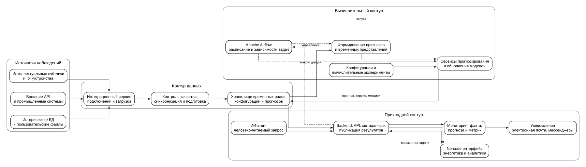
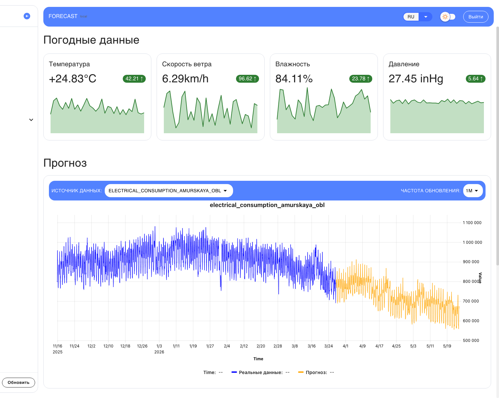
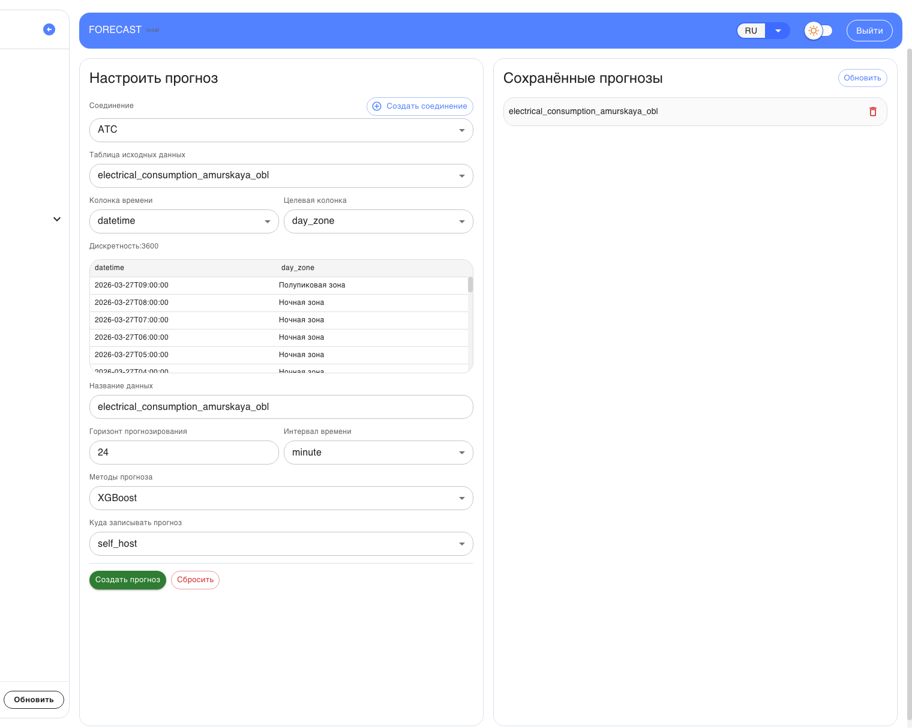
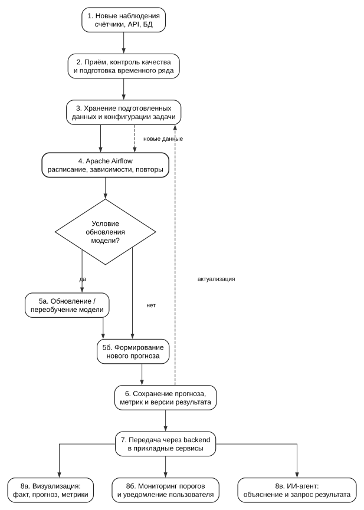
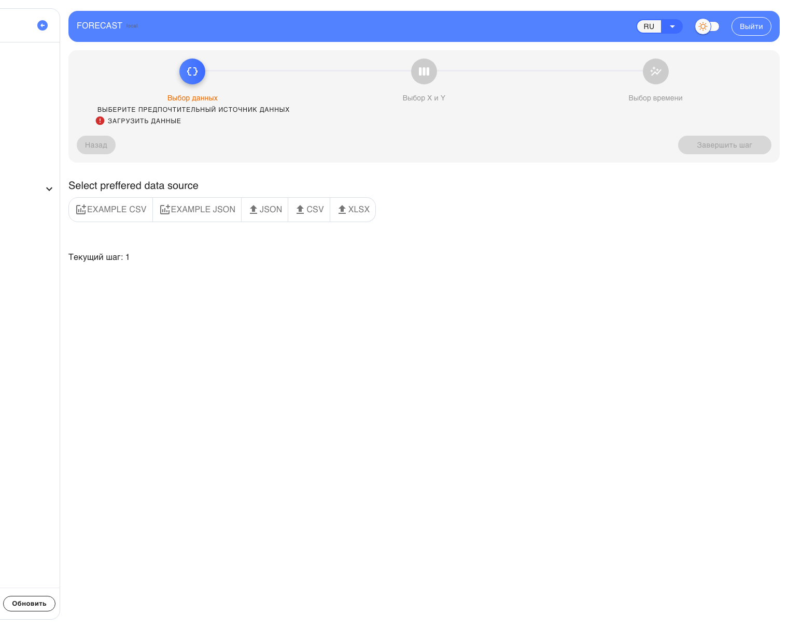
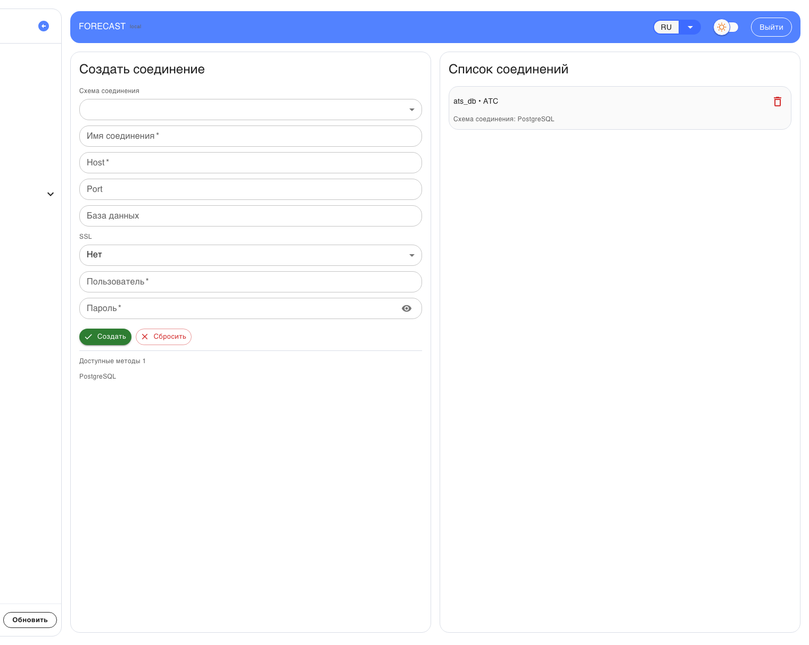
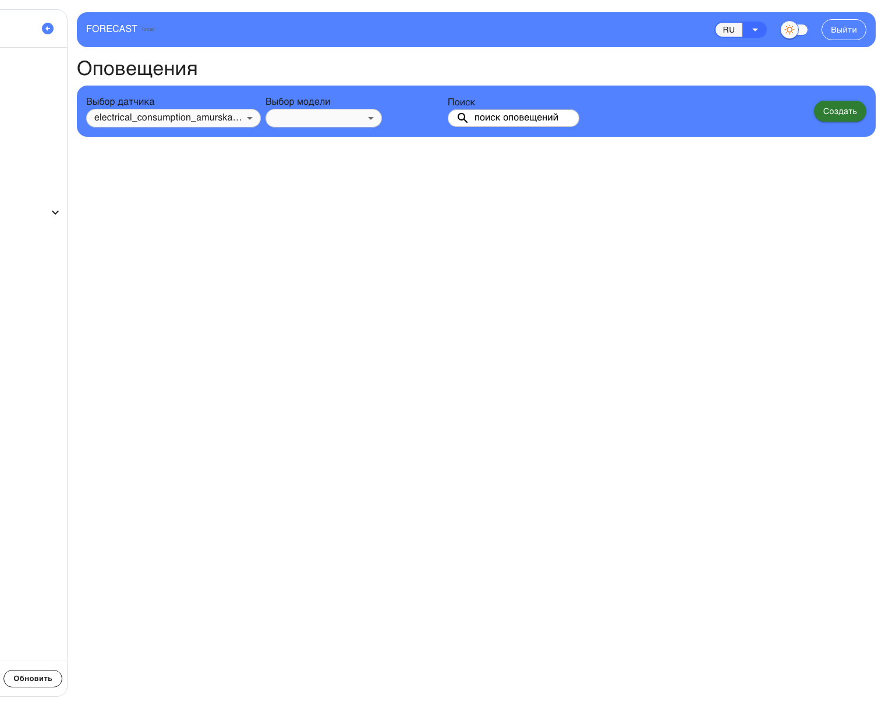
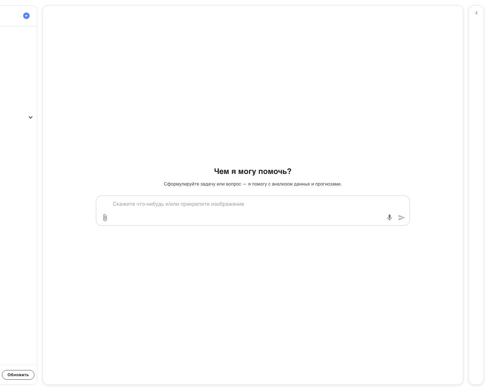

# Глава 3. Разработка программно-аппаратного комплекса для интеллектуального анализа, мониторинга и прогнозирования временных рядов

## Введение к главе. Актуальность разработки

Цифровизация производственных и сервисных процессов привела к тому, что временные ряды стали базовой формой представления наблюдений. Потребление электроэнергии, выпуск продукции, остатки, параметры технологического оборудования, сетевой трафик и показатели спроса фиксируются с заданной периодичностью и требуют не только хранения, но и своевременной интерпретации. В этих условиях прогнозирование выполняет прикладную функцию: оно переводит накопленные наблюдения в основание для планирования ресурсов, контроля режима и оперативной реакции. Для энергетики задача особенно значима, поскольку ошибка прогноза влияет на балансирование нагрузки, подготовку резервов и режим работы инфраструктуры [1–3].

Актуальность определяется переходом от изолированного аналитического расчёта к непрерывному жизненному циклу временного ряда. В классическом сценарии специалист получает выгрузку, вручную очищает её, выбирает метод, запускает расчёт и переносит результат в отчёт. Такой маршрут трудно регулярно повторять при появлении новых записей, изменении состава признаков или увеличении числа объектов. Обзор систем обработки больших временных данных показывает, что ценность прогнозирования возрастает, когда анализ, прогноз и обнаружение аномалий выполняются в контуре поступающих потоков, а архитектура объединяет источник, обработку, хранение и представление результата [4].

Развитие no-code и low-code средств создаёт предпосылки для переноса части этой работы от разработчика к предметному специалисту. В работе E. B. Varga и Y. Guichi показано, что web-платформа для прогноза временных рядов позволяет пользователю экспериментировать с методами без написания программного кода [5]. Система EasyTime развивает тот же вектор: помимо автоматизированного сравнения методов она использует естественно-языковой вопросно-ответный модуль для объяснения результатов и выбора подхода [6]. Для промышленного применения этого недостаточно: удобство запуска должно сопровождаться интеграцией с источниками данных, сохранением конфигурации, контролем качества и регламентом обновления. Поэтому предметом разработки становится не только интерфейс модели, но и программно-аппаратный контур её эксплуатации.

Другим фактором актуальности является рост объёма и неоднородности данных. Телеметрия, показания счётчиков, журнал событий, внешние API и корпоративные базы имеют различную частоту, задержки и структуру. Их объединение требует согласованной временной оси, проверок пропусков и последовательности операций. Анализ потоковых фреймворков для временных рядов отмечает, что мониторинг, прогнозирование и обнаружение аномалий получают наибольшую прикладную ценность при обработке данных по мере поступления [4]. Следовательно, архитектура должна поддерживать как начальную загрузку файлов, так и регулярное получение наблюдений из баз и интерфейсов.

Практика использования прогнозов выходит за границы энергетики. В исследованиях и отраслевых обзорах отмечено применение временных моделей для планирования спроса и материалов в производстве и логистике, для контроля технического состояния оборудования, для планирования нагрузки в медицинских организациях, а также для анализа продаж и поведения пользователей [7–10]. Общим для этих предметных областей является не совпадение математических моделей, а потребность в воспроизводимом процессе: подготовить ряд, получить прогноз, увидеть отклонение и передать результат ответственному исполнителю. Разрабатываемый комплекс ориентирован на энергетический сценарий, но его архитектурные границы позволяют применять тот же контур к другим производственным и бизнес-временным рядам.

Отдельную актуальность приобретает интерпретируемость. В условиях, когда на прогноз опирается инженерное или управленческое решение, пользователь должен видеть не только итоговое число, но и временной диапазон данных, выбранный метод, метрики качества и фактическое поведение ряда после выпуска прогноза. Методы объяснимого искусственного интеллекта, включая SHAP и Grad-CAM, рассматриваются как средства анализа вклада признаков в задачах энергетического прогнозирования [11]. В комплексе интерпретируемость реализуется на эксплуатационном уровне: версия данных и модели сохраняется вместе с результатом, а пользователь видит факт и прогноз на общей временной шкале. Это не исключает применения специальных XAI-методов, но обеспечивает необходимую для работы прослеживаемость.

Патентный ландшафт подтверждает устойчивый интерес к аппаратно-программным решениям для прогнозирования нагрузки, анализа временных рядов, обнаружения аномалий и поддержки решений. В нём представлены решения для прогноза энергопотребления [12–17], планирования спроса и запасов [18–20], обработки промышленных и медицинских временных рядов [21–25], а также сервисы аномалий и многомерного мониторинга [26–30]. Это показывает сформированность отдельных технических направлений. Одновременно необходимость интегрировать их в доступный инженерному пользователю сценарий — от источника до уведомления и объяснения — сохраняет практическую значимость разработки.

Таким образом, актуальность главы обусловлена четырьмя взаимосвязанными обстоятельствами: ростом числа потоковых данных, потребностью в регулярном прогнозе и контроле отклонений, распространением no-code и агентных интерфейсов, а также необходимостью обеспечить воспроизводимость и интерпретируемость результатов. Предлагаемый программно-аппаратный комплекс отвечает на эти условия организацией полного цикла анализа временного ряда, в центре которого находится автоматическая оркестрация задач и понятное пользователю представление результата.

## 3.1. Постановка задачи и требования к комплексу

Электропотребление представлено временным рядом, который формируется под действием производственного режима, календаря, погоды, состояния оборудования и поведения потребителей. Поэтому задача кратко- и среднесрочного прогноза не ограничивается выбором математической модели. Для инженерной службы важны регулярное получение наблюдений, сопоставление факта с рассчитанной траекторией, обновление результата после поступления данных и понятная фиксация причин отклонений. Обзоры методов прогнозирования нагрузки подтверждают значимость сезонности, внешних факторов, корректной оценки качества и устойчивого процесса работы с данными [1–3, 31].

Объектом разработки является программно-аппаратный комплекс интеллектуального анализа, мониторинга и прогнозирования временных рядов электропотребления. Под ним понимается не отдельная программа, а связанная совокупность источников измерений, вычислительных узлов, хранилищ, сервисов обработки и пользовательских средств. Комплекс должен преобразовывать телеметрию, архивы, внешние данные и файлы в регулярно обновляемый прогноз, доступный инженерному пользователю без написания программного кода.

Целевыми пользователями выступают инженер по энергоменеджменту, диспетчер, аналитик и руководитель. Аналитику требуется задать источник, целевую переменную, временную колонку, дискретность, метод и горизонт. Диспетчеру необходимы экран текущего состояния, фактическая и прогнозная траектории, а также правило уведомления. Руководитель использует сводное представление и может получать пояснения в диалоговой форме. Следовательно, интерфейс должен скрывать внутренние вычислительные детали, но сохранять связь результата с его настройкой, данными и временем расчёта.

Исходные наблюдения могут поступать от интеллектуальных приборов учёта, датчиков и IoT-устройств, из корпоративных систем, исторических баз, внешних API и пользовательских файлов. Перед расчётом следует проверять наличие временной метки, пропуски, дубликаты, порядок записей, согласованность дискретности и допустимость значений. Иначе дефект регистрации будет ошибочно интерпретирован как изменение режима энергопотребления. В хранилище необходимо отделять исходные записи, подготовленные наборы, признаки, версии моделей, прогнозы, метрики и служебные журналы. Такое разделение делает расчёт воспроизводимым и позволяет показать, из какого временного среза получен результат.

Модель рассматривается как сервис внутри общего конвейера. В зависимости от задачи могут использоваться статистические, бустинговые и нейросетевые методы, однако пользовательский маршрут не должен меняться при выборе метода. В качестве примера преобразования календарной структуры применяется Time2Vec, переводящий значение времени в вектор признаков для прогнозной модели [32]. В данной работе это не самостоятельный объект исследования, а один из возможных элементов этапа подготовки данных.

Ключевое требование состоит в автоматизации регламента. Новые наблюдения появляются с разной периодичностью, а выпуск прогноза и обновление модели имеют разные вычислительные затраты. Поэтому центральным механизмом управления выбран Apache Airflow. Он позволяет описывать прикладной процесс направленным графом задач, зависимостей и расписаний; планировщик запускает готовые стадии после выполнения необходимых условий [33–35]. Пользователь создаёт не разовый запуск, а конфигурацию повторяемой задачи, которую система исполняет и наблюдает по регламенту.

Требования к комплексу включают интеграцию с внешними источниками, no-code настройку, контроль качества, раздельное хранение результатов, автоматический прогноз и управляемое обновление модели. Дополнительно требуются совместная визуализация факта и прогноза, уведомления при заранее определённых условиях и человеко-читаемое взаимодействие через ИИ-агента. Успех разработки определяется тем, что она доводит запись измерения до инженерного действия, а не только выдаёт численное значение модели.

## 3.2. Сравнительный анализ инструментов промышленной работы с временными рядами

Средства промышленного анализа временных рядов относятся к разным классам. Одни предоставляют прогнозную модель через программный интерфейс, другие концентрируются на потоковой интеграции, третьи реализуют корпоративный AutoML и MLOps, четвёртые ориентированы на технологические процессы. Поэтому сопоставление проведено по полноте пользовательского сценария: подключению данных, настройке без кода, выпуску прогноза, мониторингу и реакции на событие, а не по абстрактному наличию алгоритма.

В качестве аналогов рассмотрены Nixtla TimeGPT, Striim, DataRobot, ICONPro TSAF и H2O Driverless AI. Выбор связан с пересечением по прогнозированию, потоковой работе с данными, управлению моделями, промышленной аналитике и автоматизированной подготовке временных признаков. Использованы опубликованные функциональные описания производителей [36–42]. Сравнение относится к назначению и составу пользовательского маршрута; оно не предполагает тождественности всех рассматриваемых решений.

Таблица 3.1 — Конкурентный анализ средств прогнозирования временных рядов

| Параметр анализа | Horizon TSD | Folio3 | Nixtla | Striim | DataRobot | ICONPro TSAF | TimeSeriesLab | H2O |
|---|---|---|---|---|---|---|---|---|
| Основная ценность продукта | Экосистема прогнозирования: API, no-code дашборд, уведомления и ИИ-агент; сценарий от Excel до рекомендаций | Кастомные ML-решения и консалтинг по временным рядам | Экосистема TimeGPT, foundation model и эффективный инференс | Потоковая аналитика реального времени с ML-прогнозом и аномалиями | Enterprise AutoML, agentic AI, наблюдаемость и бизнес-приложения | Промышленный прогноз и аномалии с интеграцией в MES/SPC | Локальное ПО со статистическими моделями для аналитиков | AutoML для временных рядов в Driverless AI и H2O AI Cloud |
| Скорость и простота интеграции: API, БД | API, импорт CSV/Excel и подключения к БД для быстрого встраивания | API-поддержка, но чаще интеграция в составе кастомного проекта | Быстрый старт через dashboard/SDK и открытые библиотеки | Flow Designer, коннекторы CDC и файловые источники | Коннекторы Snowflake, S3, SQL и другие enterprise-интеграции | Python-пакет, Docker или web-service; on-prem и cloud | Экспорт и пакетная интеграция локального движка | Enterprise-интеграции, feature store, cloud и on-prem |
| Интерфейсы: no-code/low-code, дашборды, файлы | No-code прогноз из Excel/CSV и API для разработчика | Услуги и готовые модели без выделенного публичного no-code дашборда | Dashboard и инструменты быстрого старта, преимущественно для разработчиков | Визуальная конфигурация потоков и агент Foreseer | AI Apps, Agents и студии для бизнес-пользователей | Low-code интерфейс для инженеров и интеграция с MES | GUI на рабочей станции для моделирования | Driverless AI, H2O Wave и LLM Studio |
| Управление рисками и оповещения | Настраиваемые уведомления, пороги и обнаружение аномалий | Акцент на прогнозировании и консалтинге; самостоятельные уведомления не выделены | Акцент на точности инференса; alerting не является основным сценарием | Alerting в реальном времени и публикация в каналы | Наблюдаемость моделей, триггеры и оркестрация в enterprise-контуре | Аномалии, превышения лимитов и интеграция с производственными системами | Исследовательское моделирование без встроенного проактивного контура | MLOps-мониторинг и алерты через развёрнутые сценарии |
| ИИ-агент или чат-интерфейс | Встроенный агент для прогнозов, объяснений и рекомендаций | Агенты и чат-боты как часть услуг, а не публичный продуктовый модуль | Foundation model; чат-агент не выделен как основной компонент | Foreseer для настройки потоковых прогнозов и анализа | Agentic AI и средства создания и эксплуатации агентов | Автоматизация и интеграция без центральной роли чат-агента | Агентный интерфейс отсутствует | h2oGPTe и LLM Studio поддерживают агентные функции |
| Гибкость и кастомизация | Готовые сценарии, API и адаптация интеграций | Высокая кастомизация в консалтинговой модели | Комбинация open-source и enterprise-вариантов | Гибкая настройка потоковых конвейеров | Широкая enterprise-кастомизация | Docker, Python, on-prem/cloud и отраслевая адаптация | Локальная настройка для исследовательских задач | Настройка моделей, MLOps и вариантов развёртывания |
| Ценовая модель | Подписка SaaS, enterprise-пакеты и проектные услуги | Консалтинговая и enterprise-модель по запросу | Open-source и enterprise-поддержка | Enterprise-платформа и облачные планы | Enterprise-модель с поставкой по запросу | Enterprise-лицензирование и сервисы | Основная версия свободна для использования; специальные редакции и консультации | Open-source и коммерческие облачные/enterprise-предложения |
| Поддержка форматов и подготовка | Прямая загрузка CSV/Excel и автоматическая подготовка типовых наборов | Исторические данные и CSV в рамках интеграционного проекта | Dashboard/SDK для стандартных форматов загрузки | Файлы, потоки, обработка пропусков | Табличная загрузка и интеграция с хранилищами | Ряды из разных источников и автоматическая подготовка | Ряды и экзогенные переменные при базовых навыках моделирования | Разные источники, пропуски и высококардинальные признаки |
| Проактивность: предупреждения и рекомендации | Предупреждения и рекомендации по риск-сценариям | Прогноз и консалтинг без выделенной автоматической подсистемы оповещений | Мощные предсказания; рекомендации и оповещения не являются ключевым акцентом | Потоковое выявление аномалий и публикация событий | Agentic AI и observability для проактивных процессов | Аномалии, change-points и предупреждения о лимитах | Анализ и моделирование без активных уведомлений | MLOps и GenAI-приложения для рекомендаций и оповещений |

Nixtla TimeGPT представляет модельный сервис: данные подготавливаются во внешней среде, после чего прогноз получается вызовом интерфейса. Такой подход рационален для разработчика, уже располагающего инфраструктурой, но сам по себе не задаёт маршрут от счётчика до экрана диспетчера. Striim решает важную задачу доставки и преобразования потоков; в прогнозном контуре его возможности дополняются сервисом подготовки временного ряда и вызовом модели.

DataRobot объединяет AutoML, развёртывание и MLOps, включая визуальные приложения для временных задач. H2O Driverless AI автоматизирует признаки, лаги, календарные переменные и проверку моделей во временных рядах [38–41]. Эти решения полезны для аналитического и корпоративного слоя, но конкретный регламент энергоменеджмента требует связи источника, времени расчёта, версии данных, графика факта и правила реакции. ICONPro TSAF ориентирован на промышленный анализ, где прогноз рассматривается в контексте процесса [42].

Особенность разрабатываемого комплекса состоит в композиции перечисленных операций в едином no-code сценарии. Инженер выбирает доступный источник и параметры задачи; конфигурация сохраняется, наблюдения извлекаются по регламенту, проходят проверку, поступают в модельный сервис и публикуются как прогноз. Фактическая и прогнозная траектории отображаются совместно, а отклонение может активировать уведомление. Преимущество носит прикладной характер: сокращается число ручных переходов между разными средствами и исключается необходимость повторять одинаковые действия после каждого обновления данных.

## 3.3. Архитектура программно-аппаратного комплекса

Архитектура разделяет ответственность между интеграцией, хранением, вычислением, оркестрацией и пользовательским взаимодействием. На физическом уровне находятся приборы учёта, датчики, IoT-устройства и серверные вычислительные узлы. Они не рассматриваются как уникальное оборудование: компоненты подключаются по сетевым интерфейсам и могут заменяться без изменения пользовательского сценария. К ним добавляются исторические базы, корпоративные системы, внешние API и файлы, используемые при первичном подключении.

На серверной стороне выделяются сервисы приёма и проверки данных, хранилище временных рядов, сервисы прогнозных моделей, контур оркестрации, прикладной backend и пользовательский frontend. Такое разделение даёт возможность независимо увеличивать ресурсы получения телеметрии, хранения, расчёта моделей и обслуживания интерфейсных запросов. Рост частоты измерений прежде всего затрагивает интеграцию и хранилище, а рост числа прогнозных заданий — вычислительный контур, не изменяя форму задания для пользователя.

*Рисунок 3.1 — Архитектура программно-аппаратного комплекса интеллектуального анализа, мониторинга и прогнозирования временных рядов*

Интеграционный слой создаёт соединения с базами данных и внешними интерфейсами, получает таблицы и файлы, приводит записи к единому внутреннему формату. В интерфейсе пользователь выбирает соединение, доступную таблицу, временную колонку и целевой показатель. Контроль качества выполняет проверку временной оси, пропусков, повторов и дискретности. Он не заменяет производственные записи незаметным образом: результат проверки и причина исключения должны сохраняться как метаданные задания.

Таблица 3.2 — Компоненты комплекса и их функции

| Компонент | Функция | Результат |
|---|---|---|
| Источники и внешние системы | Формируют первичные измерения и контекстные признаки | Наблюдения, архивы, погодные и календарные данные |
| Сервис интеграции | Создаёт соединения, получает таблицы и файлы | Набор наблюдений с метаданными |
| Контроль качества и подготовка | Проверяет временную ось, строит признаки | Подготовленный набор для расчёта |
| Хранилище временных рядов | Разделяет данные, прогнозы, метрики и версии | Воспроизводимые сущности контура |
| Сервисы моделей | Выполняют прогноз, эксперимент и обновление | Прогноз, метрики, версия модели |
| Apache Airflow | Планирует зависимости, повторы и очередность | Исполненный конвейер и состояние стадий |
| Backend и интерфейс | Предоставляют прикладные операции и визуализацию | Настройка, график, таблица, статус |
| Уведомления и ИИ-агент | Сообщают о событии и поддерживают диалог | Сообщение или человеко-читаемый ответ |

Слой моделей имеет единый контракт: получить подготовленные данные, горизонт и параметры, а вернуть прогноз, показатели качества и сведения о версии. Благодаря этому интерфейс не привязан к конкретному алгоритму. Пользователь выбирает доступный метод, а система сохраняет его вместе с конфигурацией. Сравнение экспериментов становится корректным, когда метрики и прогнозные траектории относятся к одному и тому же срезу данных и горизонту.

Airflow располагается над интеграционными и модельными операциями как уровень управления, а не как хранилище или витрина. Граф задач делает явными зависимости «получение — проверка — подготовка — обновление — прогноз — публикация». Планировщик поддерживает календарные интервалы, интервальные правила и специализированные таблицы времени [33–35]. На прикладном уровне выделяются контур планируемого прогноза schedule_forecast, операции получения прогноза и обновления модели, сервис метрик, менеджер уведомлений и диалоговый сервис агента. Пользователь работает с предметными сущностями, а не с внутренними вызовами.

Отдельное значение имеет прослеживаемость результата. Для каждой опубликованной прогнозной траектории сохраняются идентификатор задания, временные границы исходного среза, время выполнения, применённый метод, версия модели и показатели качества. При обновлении данных создаётся новый срез, а ранее сформированный прогноз не подменяется без указания времени и версии. Такой подход позволяет сопоставить траектории, объяснить различия и воспроизвести расчёт. Он разделяет рабочую витрину, в которой пользователь видит актуальный результат, и внутренний слой хранения, сохраняющий историю вычислений.

Для временных рядов значима проверка не только отдельного значения, но и контекста его поступления. Если в очередной порции отсутствует временной интервал, система фиксирует разрыв; повторное значение не должно создавать ложное увеличение наблюдений; изменение дискретности отражается в конфигурации подготовки. Поэтому контроль качества выступает предшественником прогноза и обновления модели. Его результат становится для оркестратора условием перехода к следующей стадии, а для пользователя — информацией о пригодности данных к содержательной интерпретации.

Предусмотрены два контура доступа к результатам. Пользовательский контур возвращает графики, таблицы, статусы и значения метрик. Интеграционный контур предоставляет программно доступные прогнозы и события внешним системам без воспроизведения действий в браузере. Единый backend согласует эти представления, так что один расчёт имеет одинаковую интерпретацию на экране, в уведомлении и во внешнем запросе. Это существенно при разделении ролей: аналитик настраивает задачу, а диспетчер использует её результат в процессе мониторинга.

Модельный контур предусматривает использование взаимозаменяемых классов методов: рекуррентных и двунаправленных рекуррентных нейронных сетей LSTM и BiLSTM, ансамблевых методов CatBoost и XGBoost, а также модели Prophet. Они имеют разные предпосылки и потому не должны рассматриваться как универсально взаимозаменяемые: доступный метод выбирается в конфигурации задачи, а сравнение производится на одинаковых срезах, горизонтах и метриках. Для временных признаков используется модификация Time2Vec. Она формирует векторное представление момента времени на основе линейной и периодических компонент; дополнительные гармонические и нелинейные преобразования задаются в слое подготовки признаков. Благодаря такому месту в архитектуре преобразование может использоваться модельными сервисами без изменения интерфейса постановки задачи.

Инфраструктурный слой допускает два способа встраивания. Первый — no-code маршрут, в котором пользователь загружает CSV или Excel, либо выбирает подготовленное соединение с базой данных, а система выполняет подготовку, расчёт и публикацию результата. Второй — headless-режим с REST API, когда внешняя корпоративная система передаёт данные и получает прогноз без обращения к браузерному интерфейсу. Развёртывание возможно на серверной инфраструктуре организации либо в совместимой облачной среде. В обоих вариантах архитектура сохраняет общий контракт данных, версионирование и регламент Airflow; меняется только способ доступа к операциям комплекса.

Автоматические отчёты и уведомления связывают вычислительный контур с корпоративными каналами коммуникации. После публикации прогноза backend формирует доступное интерфейсу представление, а подсистема уведомлений передаёт событие по настроенному каналу. ИИ-агент может сформулировать пояснение и подготовить краткое описание состояния, однако действия, меняющие конфигурацию задания или правило уведомления, должны оставаться наблюдаемыми и подтверждаемыми пользователем. Такая организация сочетает удобство диалогового взаимодействия с контролем технически значимых операций.

*Рисунок 3.3 — Пример визуализации фактического и прогнозного значений временного ряда в интерфейсе мониторинга*

Функциональное назначение экрана — ежедневный мониторинг прогнозного контура. Фактический и прогнозный ряды показаны на общей временной шкале вместе с основными показателями и сведениями о частоте данных. Инженер может сопоставить направление отклонения, период, на котором оно возникло, и используемую для расчёта конфигурацию. Таким образом, экран связывает численный результат модели с проверкой текущей динамики процесса.

## 3.4. Автоматическое обновление прогнозов и пользовательские сценарии

Центральным результатом проектирования является регламент автоматического обновления прогнозов. Он представляет последовательность управляемых операций, а не безусловное переобучение после каждой записи. Для задания фиксируются источник, таблица или набор данных, временное поле, целевой показатель, дискретность, горизонт, метод, интервал запуска и место сохранения результата. Конфигурация создаётся в no-code форме и далее используется оркестратором.

*Рисунок 3.4 — Настройка источника, временного поля, горизонта и метода для планируемого прогноза*

Функциональное назначение формы — перевод прикладной задачи в воспроизводимую конфигурацию. Пользователь последовательно выбирает соединение, таблицу, временную и целевую колонки, дискретность, горизонт, доступный метод и периодичность. После сохранения эта форма становится входом для оркестратора: при следующем цикле не требуется повторно задавать параметры или запускать код вручную.

После сохранения конфигурации Airflow проверяет наступление периода либо другого предусмотренного условия и разрешает выполнение зависимых стадий. Сервис интеграции извлекает новые наблюдения. Затем выполняются контроль качества и подготовка: уточняется временная ось, формируются признаки, новые записи сопоставляются с последним обработанным моментом. После этого определяется, требуется ли выпуск прогноза на текущей версии модели или её обновление с последующим расчётом.

*Рисунок 3.2 — Последовательность автоматического обновления данных, модели и прогноза*

Решение об обновлении модели задаётся регламентом и состоянием данных. Основанием могут быть накопление валидных наблюдений, наступление интервала обновления, изменение метрик на контрольном участке или выявление структурного сдвига. Структурный сдвиг означает изменение статистической связи вследствие смены режима, сезона, технологии или внешних условий; его нельзя смешивать с одиночным выбросом. Подходы к адаптации к concept drift рассматриваются в [43, 44].

Разделение ветвей необходимо для эксплуатационной устойчивости. Прогноз может выпускаться чаще, чем обновляется модель, если телеметрия поступает с высокой частотой, а новой информации недостаточно для обоснованного переобучения. При выполнении условия обновления модельный сервис получает подготовленные данные и возвращает новую версию; затем прогноз строится на её основе. В обоих случаях хранятся идентификатор задания, временная область, время расчёта, метод, версия и метрики.

Таблица 3.3 — Регламент автоматического конвейера

| Этап | Исполнитель | Условие | Фиксируемый результат |
|---|---|---|---|
| Получение наблюдений | Интеграционный сервис | Доступен источник и наступило время запуска | Порция записей и отметка времени |
| Проверка и подготовка | Сервис качества | Временные поля и значения пригодны | Подготовленный набор и журнал проверок |
| Проверка модели | Оркестратор и модельный сервис | Накоплены данные, наступил интервал или изменились метрики | Решение об обновлении либо сохранении версии |
| Обновление модели | Модельный сервис | Условие обновления выполнено | Новая версия и показатели контроля |
| Выпуск прогноза | Сервис прогноза | Имеется пригодная версия и горизонт | Прогнозная траектория |
| Публикация | Backend, UI, уведомления | Результат сохранён | График, метрики, уведомление по правилу |

Пользовательский путь начинается с данных. Быстрый сценарий позволяет выбрать CSV, JSON или XLSX, назначить временную и целевую колонки и просмотреть набор. Он подходит для первичной проверки либо разовой задачи. Для регулярной работы тот же смысл переносится в планируемое задание, где источник и параметры сохраняются для повторного исполнения.

*Рисунок 3.6 — No-code сценарий выбора источника и целевого временного ряда*

Функциональное назначение сценария — быстрое подключение и первичная проверка набора. Выбор формата, временной и целевой колонок позволяет до запуска регулярной задачи увидеть структуру ряда и назначить смысл полей. Этот маршрут полезен как для первоначальной загрузки, так и для проверки альтернативного источника, не изменяя уже действующую конфигурацию.
Подключение к хранилищу выделено в отдельный маршрут. Пользователь указывает тип базы и параметры соединения, затем выбирает таблицы и поля. Такая конфигурация опирается на именованное соединение и схему, а не на файл, известный одному специалисту.

*Рисунок 3.7 — Интерфейс подключения и выбора источника данных*

Функциональное назначение экрана — администрирование интеграции. Пользователь создаёт и выбирает соединение с хранилищем, после чего может использовать доступные таблицы в прогнозных заданиях. Выделение этого шага в отдельный экран делает подключение повторно применимой сущностью и исключает зависимость прогноза от локальной выгрузки одного пользователя.
После публикации прогноза мониторинговый контур сопоставляет ожидаемую и фактическую динамику. Правило уведомления связывает выбранный контур с условием и каналом доставки. Диспетчер не обязан непрерывно наблюдать график: при наступлении заранее заданного события формируется сообщение, которое становится основанием для проверки причины отклонения.

*Рисунок 3.5 — Настройка правила уведомления по данным мониторинга*

Функциональное назначение формы — превратить наблюдаемое отклонение в регламентированное событие. В ней задаются связанный объект мониторинга, условие срабатывания и канал доставки. Благодаря этому система не только отображает прогноз, но и передаёт ответственному специалисту сигнал, требующий проверки контекста и принятия решения.
ИИ-агент образует дополнительный человеко-читаемый слой. Пользователь формулирует вопрос в предметных терминах: уточняет состояние задания, значение показателя или порядок настройки. Агент не заменяет контроль доступа и регламент выполнения: он использует только доступные пользователю данные и операции, сокращая путь от вопроса специалиста к корректному действию.

*Рисунок 3.8 — Человеко-читаемый интерфейс взаимодействия с ИИ-агентом*

Функциональное назначение диалогового интерфейса — помочь пользователю ориентироваться в доступных рядах, прогнозах, метриках и действиях. Запрос формулируется на естественном языке, а ответ должен опираться на контекст доступной конфигурации. Агент дополняет формы настройки и графики, сокращая путь от вопроса к нужной операции, но не заменяет права доступа и подтверждение значимых действий.
Таблица 3.4 — Пользовательские сценарии и результат

| Роль | Действие | Автоматизированная операция | Результат |
|---|---|---|---|
| Инженер | Подключает источник, выбирает время и цель | Создание конфигурации данных | Прогнозное задание |
| Аналитик | Выбирает метод, горизонт и интервал | Подготовка, расчёт, сохранение метрик | Сравнимые версии прогнозов |
| Диспетчер | Смотрит факт и прогноз, создаёт правило | Публикация и проверка события | Оперативное уведомление |
| Руководитель | Открывает сводный экран или обращается к агенту | Представление доступных данных в прикладной форме | Понятная картина состояния |

Эксплуатационный регламент различает три временных масштаба. На коротком масштабе поступают измерения и обновляется представление фактических значений. На среднем масштабе выпускается прогноз с заданным горизонтом. На более длинном масштабе накапливается массив, достаточный для оценки качества и обновления параметров модели. Эти интервалы не должны совпадать: например, значения могут публиковаться с малым шагом, а пересмотр модели выполняться только после появления пригодного объёма новых наблюдений. Конфигурация задания делает различие явным и не смешивает частоту телеметрии с частотой обновления модели.

Уведомление завершает цепочку мониторинга, а не является изолированным сообщением. В правиле определяются объект наблюдения, условие, получатель и канал доставки. После срабатывания специалист открывает соответствующую траекторию, проверяет фактические данные и контекст расчёта. Следовательно, автоматизация ускоряет передачу информации, но сохраняет за инженером интерпретацию причин изменения нагрузки. Накопленные результаты проверок позволяют позднее уточнять горизонты, условия срабатывания и режим обновления.

Диалог с ИИ-агентом дополняет, но не заменяет визуальные формы. Он полезен, когда пользователь может сформулировать задачу естественным языком, однако для действий, влияющих на конфигурацию или уведомление, система должна возвращать ясное подтверждение выбранных параметров. Благодаря этому агент становится средством навигации по предметным сущностям — источнику, ряду, прогнозу, метрике и правилу, — а не непрозрачным самостоятельным вычислительным контуром. В сочетании с графиками и таблицами такой способ взаимодействия снижает порог использования сложной инфраструктуры для специалистов, не работающих с программным кодом ежедневно.

## 3.5. Научная новизна и практическая значимость разработки

Научная новизна заключается в разработке подхода к организации комплекса, в котором прогнозная модель включена в управляемый цикл поступления данных, контроля качества, обновления, публикации результата и человеко-читаемого взаимодействия. Новизна относится к архитектурно-методическому уровню: формализуется связь между параметрами задачи, состоянием данных, версией модели и эксплуатационным результатом. Прогнозирование становится непрерывным процессом, а не изолированным вычислением на неизменном наборе наблюдений.

> Разработка программно-аппаратного комплекса для интеллектуального анализа, мониторинга и прогнозирования временных рядов, обеспечивающего автоматическое обновление прогнозов, визуализацию результатов, интеграцию с системами сбора и хранения данных, а также поддержку человеко-читаемого взаимодействия посредством ИИ-агентов.

Первый элемент новизны — единая конфигурация прикладной задачи, включающая источник, время, целевой показатель, дискретность, горизонт, метод и правила исполнения. Она устраняет неоднозначность между графиком, набором данных и версией расчёта. Второй элемент — применение Airflow как механизма адаптивного регламента. Цепочка «источник — проверка — подготовка — решение об обновлении — прогноз — публикация» имеет явные зависимости и наблюдаемые результаты. Важна не декларация преимущества конкретной модели, а возможность согласовать получение данных, обновление и предоставление прогноза пользователю.

Третий элемент — включение прогноза в оперативный контур. Визуализация фактической и ожидаемой траекторий, метрики, уведомления и ИИ-агент образуют единый путь от расчёта к интерпретации. Для энергопотребления специалисту требуется не только значение на горизонте, но и возможность увидеть расхождение, проверить контекст и быстро уточнить дальнейшее действие.

> Программно-аппаратный комплекс для интеллектуального анализа, мониторинга и прогнозирования временных рядов, обеспечивающий автоматическую адаптацию параметров моделей при изменении структуры временного ряда и интеграцию с внешними источниками данных и интеллектуальными системами управления и мониторинга временных рядов, позволяет повысить оперативность обновления прогнозов и сократить время реакции системы.

Содержательно предлагаемый подход отличается от простого календарного запуска модели. Календарь определяет момент проверки задания, но не заменяет анализа состояния данных. Перед обновлением должны быть известны результаты контроля новой порции, граница последнего обработанного наблюдения, доступность подготовленных признаков и пригодность контрольного участка. Поэтому Airflow выступает средством координации, а решение о ветви конвейера основывается на явных признаках состояния: регламентном интервале, объёме валидных данных, показателях качества и признаках изменения структуры ряда. Такое распределение ответственности позволяет сохранить прозрачность процесса: планировщик не оценивает физическую природу нагрузки, а модельный и подготовительный сервисы передают ему формализованный результат.

Практически полезна также версия конфигурации. Параметры горизонта, источника, таблицы, целевой колонки, метода и правил обновления должны быть привязаны к конкретному запуску. Если инженер изменил горизонт или источник, новый режим не смешивается с ранее рассчитанными прогнозами. Это создаёт историю изменений, по которой можно сравнивать эксплуатационные решения: например, различить эффект нового периода данных и эффект иной настройки задачи. Визуальный интерфейс при этом делает версионность доступной без чтения технических журналов — через дату расчёта, выбранный метод, временной диапазон и показатели результата.

Предлагаемый подход применим к неоднородности данных энергетического объекта. Сначала в систему может подключаться один исторический ряд с регулярной дискретностью. Затем пользователь добавляет погодные признаки, календарные режимы, сведения о состоянии оборудования или новый участок потребления. Интеграционный слой приводит эти сведения к согласованной временной основе, а контур подготовки определяет их место в наборе признаков. Благодаря тому, что граница между интеграцией и моделью фиксирована, расширение источников не требует менять способ создания задания, визуализации или уведомления. Это особенно удобно при поэтапном развёртывании, когда цифровая зрелость подразделений различается.

Человеко-читаемое взаимодействие имеет самостоятельную методическую роль. No-code форма предотвращает часть ошибок за счёт выбора допустимых сущностей и параметров, но не всегда отвечает на вопрос, почему задача не запускается, какое значение имеет метрика или что означает настройка горизонта. ИИ-агент дополняет форму пояснением на языке пользователя и направляет его к соответствующему экрану либо операции. Его ответ должен опираться на доступный контекст задания и не скрывать, какие сведения использованы. Тем самым диалоговый интерфейс становится средством снижения когнитивной нагрузки, а не альтернативой формализованной конфигурации и контролю прав доступа.

Предложенная архитектура обеспечивает масштабирование по функциональным границам. При росте числа рядов можно раздельно увеличивать ресурсы приёма данных, хранилища и прогнозных сервисов; при увеличении числа пользователей — ресурсы backend и интерфейсного слоя. Оркестратор сохраняет единый регламент для разных заданий, но ведёт состояние каждого из них отдельно. Такое свойство важно для перехода от пилотного ряда к множеству объектов: новый объект добавляется конфигурацией подключения и задачи, а не созданием отдельного изолированного приложения. Одновременно общая структура метрик, прогнозов и уведомлений сохраняет сопоставимость результатов между объектами.

Практическая значимость выражается в возможности поэтапного внедрения. Начальный контур использует архивные показания и один прогноз; далее могут быть подключены производственные базы, телеметрия, внешние факторы, уведомления и несколько групп пользователей. Сохранение общих интерфейсов позволяет менять источник или метод без перестройки пользовательского маршрута. Специалист один раз настраивает повторяемую задачу, а затем получает результат по регламенту, сохраняя содержательный контроль над горизонтом, условиями обновления и интерпретацией отклонения.

## 3.6. Выводы по главе

Разработана архитектура программно-аппаратного комплекса для интеллектуального анализа, мониторинга и прогнозирования временных рядов электропотребления. Она объединяет источники телеметрии и архивы, интеграцию, контроль качества, хранилище, сервисы моделей, Apache Airflow, прикладной backend, no-code интерфейс, уведомления и ИИ-агента.

Сравнение с Nixtla TimeGPT, Striim, DataRobot, ICONPro TSAF и H2O Driverless AI показало, что они закрывают отдельные модельные, интеграционные, AutoML- или промышленные задачи. Разрабатываемый комплекс направлен на их объединение в регламентном сценарии энергоменеджмента: от подключения источника до мониторинга и реакции на результат.

Определён процесс автоматического обновления: новые данные проходят проверку и подготовку, после чего по правилам задания выполняется прогноз либо обновление модели с последующим прогнозом. Airflow обеспечивает планирование, зависимости и наблюдаемость операций. Через интерфейс выполняются настройка задачи, просмотр факта и прогноза, создание уведомления и взаимодействие с ИИ-агентом, что формирует основу регулярного использования интеллектуального прогнозирования.

Разработанный контур сохраняет разделение между автоматизацией и инженерной ответственностью. Система обеспечивает регулярность операций, прослеживаемость данных и своевременное представление результата, однако выбор горизонта, правила обновления, условия уведомления и интерпретация расхождений остаются содержательными решениями специалиста. Такое распределение делает no-code взаимодействие не упрощённой заменой аналитической работы, а средством переноса повторяемых технических операций в наблюдаемый регламент.

Дальнейшее развитие комплекса связано с расширением состава источников, накоплением истории версий и уточнением регламентов для разных групп объектов. Архитектурное разделение интеграции, подготовки, моделей, оркестрации и представления позволяет вносить такие изменения локально, сохраняя общий пользовательский маршрут. Поэтому предложенная структура применима как для начального контура с одним рядом, так и для распределённой системы мониторинга нескольких объектов электропотребления.

## Литература

1. Vasenin D. A. et al. Forecasting Season Power Demand Using Machine Learning // IEEE Access. 2024. DOI: [10.1109/ACCESS.2024.3434652](https://doi.org/10.1109/ACCESS.2024.3434652). - Дата обращения: 15.11.2026.

2. Vasenin D. A. et al. Forecasting Day-Ahead Electricity Consumption Using LSTM // Smart Grids and Sustainable Energy. 2025. DOI: [10.1007/s40866-025-00281-1](https://doi.org/10.1007/s40866-025-00281-1). - Дата обращения: 15.11.2026.

3. Hong T., Fan S. Probabilistic Electric Load Forecasting // International Journal of Forecasting. 2016. DOI: [10.1016/j.ijforecast.2015.11.011](https://doi.org/10.1016/j.ijforecast.2015.11.011). - Дата обращения: 15.11.2026.

4. Almeida A., Brás S., Sargento S., Pinto F. C. Time Series Big Data: A Survey on Data Stream Frameworks, Analysis and Algorithms // Journal of Big Data. 2023. Vol. 10. Art. 83. DOI: [10.1186/s40537-023-00760-1](https://doi.org/10.1186/s40537-023-00760-1). - Дата обращения: 15.11.2026.

5. Baksáné Varga E., Guichi Y. No-Code Platform for Time Series Prediction // Production Systems and Information Engineering. 2022. Vol. 10, no. 3. P. 82–97. DOI: [10.32968/psaie.2022.3.7](https://doi.org/10.32968/psaie.2022.3.7). - URL: [https://real.mtak.hu/210296/](https://real.mtak.hu/210296/). - Дата обращения: 15.11.2026.

6. Qiu X. et al. EasyTime: Time Series Forecasting Made Easy // 2025 IEEE 41st International Conference on Data Engineering. 2025. DOI: [10.1109/ICDE65448.2025.00353](https://doi.org/10.1109/ICDE65448.2025.00353). - URL: [https://ieeexplore.ieee.org/document/11112941/](https://ieeexplore.ieee.org/document/11112941/). - Дата обращения: 15.11.2026.

7. Использование методов прогнозирования временных рядов для оптимизации деятельности предприятий [Электронный ресурс]. - URL: [https://cyberleninka.ru/article/n/ispolzovanie-metodov-prognozirovaniya-vremennyh-ryadov-dlya-optimizatsii-deyatelnosti-predpriyatiy](https://cyberleninka.ru/article/n/ispolzovanie-metodov-prognozirovaniya-vremennyh-ryadov-dlya-optimizatsii-deyatelnosti-predpriyatiy). - Дата обращения: 15.11.2026.

8. Big Data для прогнозирования загрузки бригад скорой медицинской помощи [Электронный ресурс]. - URL: [https://www.connect-wit.ru/big-data-dlya-prognozirovaniya-zagruzki-brigad-skoroj-meditsinskoj-pomoshhi.html](https://www.connect-wit.ru/big-data-dlya-prognozirovaniya-zagruzki-brigad-skoroj-meditsinskoj-pomoshhi.html). - Дата обращения: 15.11.2026.

9. DataRobot. No-Code AI Apps for Time Series What-If Scenarios [Электронный ресурс]. - URL: [https://www.datarobot.com/blog/no-code-ai-apps-time-series-what-if-scenarios/](https://www.datarobot.com/blog/no-code-ai-apps-time-series-what-if-scenarios/). - Дата обращения: 15.11.2026.

10. Amazon Web Services. No-Code Data Preparation for Time Series Forecasting Using Amazon SageMaker Canvas [Электронный ресурс]. - URL: [https://aws.amazon.com/blogs/machine-learning/no-code-data-preparation-for-time-series-forecasting-using-amazon-sagemaker-canvas/](https://aws.amazon.com/blogs/machine-learning/no-code-data-preparation-for-time-series-forecasting-using-amazon-sagemaker-canvas/). - Дата обращения: 15.11.2026.

11. van Zyl C., Ye X., Naidoo R. Harnessing Explainable Artificial Intelligence for Feature Selection in Time Series Energy Forecasting // Applied Energy. 2024. Vol. 353. Art. 122079. - URL: [https://repository.up.ac.za/bitstream/2263/93161/3/VanZyl_Harnessing_2024.pdf](https://repository.up.ac.za/bitstream/2263/93161/3/VanZyl_Harnessing_2024.pdf). - Дата обращения: 15.11.2026.

12. RU2744041C1. Способ и система для прогнозирования значений временного ряда с использованием искусственной нейронной сети [Электронный ресурс]. - URL: [https://patents.google.com/patent/RU2744041C1/ru](https://patents.google.com/patent/RU2744041C1/ru). - Дата обращения: 15.11.2026.

13. RU2573746C2. Systems and Methods for Well Performance Forecasting [Электронный ресурс]. - URL: [https://patents.google.com/patent/RU2573746C2/en](https://patents.google.com/patent/RU2573746C2/en). - Дата обращения: 15.11.2026.

14. JP5135308B2. Energy Consumption Prediction Method, Energy Consumption Prediction Device, and Terminal Device [Электронный ресурс]. - URL: [https://patents.google.com/patent/JP5135308B2/en](https://patents.google.com/patent/JP5135308B2/en). - Дата обращения: 15.11.2026.

15. US6577962B1. System and Method for Forecasting Energy Usage Load [Электронный ресурс]. - URL: [https://patents.google.com/patent/US6577962B1/en](https://patents.google.com/patent/US6577962B1/en). - Дата обращения: 15.11.2026.

16. WO2017183029A1. Method and System for Energy Consumption Prediction [Электронный ресурс]. - URL: [https://patents.google.com/patent/WO2017183029A1/en](https://patents.google.com/patent/WO2017183029A1/en). - Дата обращения: 15.11.2026.

17. CN103065195A. Power Demand Forecast Device, Method and System and Power Failure Detection System [Электронный ресурс]. - URL: [https://patents.google.com/patent/CN103065195A/en](https://patents.google.com/patent/CN103065195A/en). - Дата обращения: 15.11.2026.

18. US20210390498A1. Systems and Methods for Inventory Management and Optimization [Электронный ресурс]. - URL: [https://patents.google.com/patent/US20210390498A1/en](https://patents.google.com/patent/US20210390498A1/en). - Дата обращения: 15.11.2026.

19. CN111639978B. Electronic Commerce Event Driving Type Demand Forecasting Method Based on Prophet-Random Forest [Электронный ресурс]. - URL: [https://patents.google.com/patent/CN111639978B/en](https://patents.google.com/patent/CN111639978B/en). - Дата обращения: 15.11.2026.

20. US7080026B2. Supply Chain Demand Forecasting and Planning [Электронный ресурс]. - URL: [https://patents.google.com/patent/US7080026B2/en](https://patents.google.com/patent/US7080026B2/en). - Дата обращения: 15.11.2026.

21. CN117829554B. Intelligent Perception Finished Product Repair Decision Support System [Электронный ресурс]. - URL: [https://patents.google.com/patent/CN117829554B/en](https://patents.google.com/patent/CN117829554B/en). - Дата обращения: 15.11.2026.

22. US11860617B2. Forecasting Industrial Aging Processes with Machine Learning Methods [Электронный ресурс]. - URL: [https://patents.google.com/patent/US11860617B2/en](https://patents.google.com/patent/US11860617B2/en). - Дата обращения: 15.11.2026.

23. US11803793B2. Automated Data Forecasting Using Machine Learning [Электронный ресурс]. - URL: [https://patents.google.com/patent/US11803793B2/en](https://patents.google.com/patent/US11803793B2/en). - Дата обращения: 15.11.2026.

24. US12087444B2. Population-Level Gaussian Processes for Clinical Time Series Forecasting [Электронный ресурс]. - URL: [https://patents.google.com/patent/US12087444B2/en](https://patents.google.com/patent/US12087444B2/en). - Дата обращения: 15.11.2026.

25. US11404145B2. Medical Machine Time-Series Event Data Processor [Электронный ресурс]. - URL: [https://patents.google.com/patent/US11404145B2/en](https://patents.google.com/patent/US11404145B2/en). - Дата обращения: 15.11.2026.

26. US10992560B2. Time Series Anomaly Detection Service [Электронный ресурс]. - URL: [https://patents.google.com/patent/US10992560B2/en](https://patents.google.com/patent/US10992560B2/en). - Дата обращения: 15.11.2026.

27. US6745150B1. Time Series Analysis and Forecasting Program [Электронный ресурс]. - URL: [https://patents.google.com/patent/US6745150B1/en](https://patents.google.com/patent/US6745150B1/en). - Дата обращения: 15.11.2026.

28. US10187326B1. Real-Time Analysis of Multidimensional Time Series Data to Identify an Operational Anomaly [Электронный ресурс]. - URL: [https://patents.google.com/patent/US10187326B1/en](https://patents.google.com/patent/US10187326B1/en). - Дата обращения: 15.11.2026.

29. EP3671466A1. Unsupervised Anomaly Detection for Arbitrary Time Series [Электронный ресурс]. - URL: [https://patents.google.com/patent/EP3671466A1/en](https://patents.google.com/patent/EP3671466A1/en). - Дата обращения: 15.11.2026.

30. Energy Consumption or Demand Prediction or Estimation Patents and Patent Applications (Class 700/291) [Электронный ресурс]. - URL: [https://patents.justia.com/patents-by-us-classification/700/291](https://patents.justia.com/patents-by-us-classification/700/291). - Дата обращения: 15.11.2026.

31. Meisenbacher S. et al. A Review of Machine Learning for Short-Term Load Forecasting // WIREs Data Mining and Knowledge Discovery. 2022. DOI: [10.1002/widm.1475](https://doi.org/10.1002/widm.1475). - Дата обращения: 15.11.2026.

32. Kazemi S. M. et al. Time2Vec: Learning a Vector Representation of Time. 2019. - URL: [https://arxiv.org/abs/1907.05321](https://arxiv.org/abs/1907.05321). - Дата обращения: 15.11.2026.

33. Apache Airflow. DAGs. - URL: [https://airflow.apache.org/docs/apache-airflow/stable/core-concepts/dags.html](https://airflow.apache.org/docs/apache-airflow/stable/core-concepts/dags.html). - Дата обращения: 15.11.2026.

34. Apache Airflow. Scheduler. - URL: [https://airflow.apache.org/docs/apache-airflow/stable/administration-and-deployment/scheduler.html](https://airflow.apache.org/docs/apache-airflow/stable/administration-and-deployment/scheduler.html). - Дата обращения: 15.11.2026.

35. Apache Airflow. Timetables. - URL: [https://airflow.apache.org/docs/apache-airflow/stable/authoring-and-scheduling/timetable.html](https://airflow.apache.org/docs/apache-airflow/stable/authoring-and-scheduling/timetable.html). - Дата обращения: 15.11.2026.

36. Nixtla. Forecasting with TimeGPT. - URL: [https://docs.nixtla.io/docs/forecasting](https://docs.nixtla.io/docs/forecasting). - Дата обращения: 15.11.2026.

37. Striim. Striim Platform Documentation. - URL: [https://www.striim.com/docs/en/](https://www.striim.com/docs/en/). - Дата обращения: 15.11.2026.

38. DataRobot. Time Series Applications. - URL: [https://docs.datarobot.com/en/docs/classic-ui/app-builder/ts-app.html](https://docs.datarobot.com/en/docs/classic-ui/app-builder/ts-app.html). - Дата обращения: 15.11.2026.

39. DataRobot. MLOps: Deployments. - URL: [https://docs.datarobot.com/en/docs/classic-ui/mlops/deployment/index.html](https://docs.datarobot.com/en/docs/classic-ui/mlops/deployment/index.html). - Дата обращения: 15.11.2026.

40. H2O.ai. Time Series Modeling in Driverless AI. - URL: [https://docs.h2o.ai/driverless-ai/1-11-lts/docs/userguide/time-series.html](https://docs.h2o.ai/driverless-ai/1-11-lts/docs/userguide/time-series.html). - Дата обращения: 15.11.2026.

41. H2O.ai. Introduction to Driverless AI. - URL: [https://docs.h2o.ai/driverless-ai/latest-stable/docs/userguide/introduction_to_dai.html](https://docs.h2o.ai/driverless-ai/latest-stable/docs/userguide/introduction_to_dai.html). - Дата обращения: 15.11.2026.

42. ICONPRO. Time Series Analysis & Forecasting. - URL: [https://iconpro.com/wp-content/uploads/2022/03/Presse-Sheet.pdf](https://iconpro.com/wp-content/uploads/2022/03/Presse-Sheet.pdf). - Дата обращения: 15.11.2026.

43. Gama J. et al. A Survey on Concept Drift Adaptation // ACM Computing Surveys. 2014. DOI: [10.1145/2523813](https://doi.org/10.1145/2523813). - Дата обращения: 15.11.2026.

44. Tsymbal A. The Problem of Concept Drift: Definitions and Related Work. 2004. - URL: [https://www.scss.tcd.ie/publications/tech-reports/reports.04/TCD-CS-2004-15.pdf](https://www.scss.tcd.ie/publications/tech-reports/reports.04/TCD-CS-2004-15.pdf). - Дата обращения: 15.11.2026.
