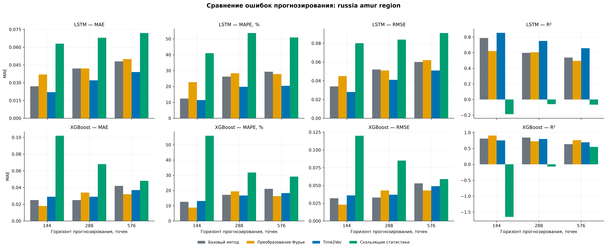
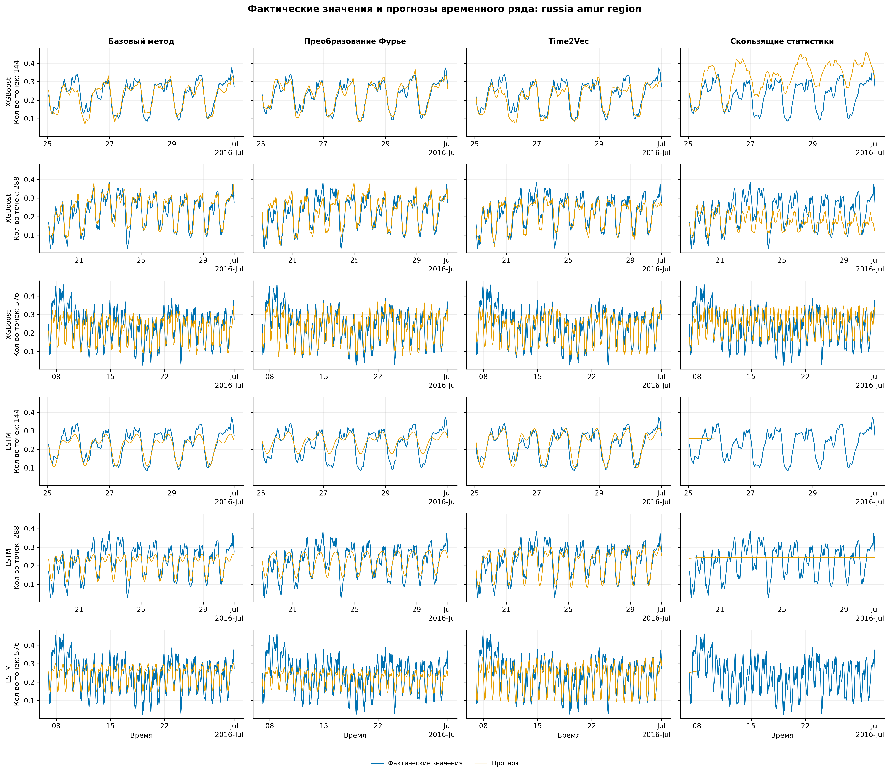
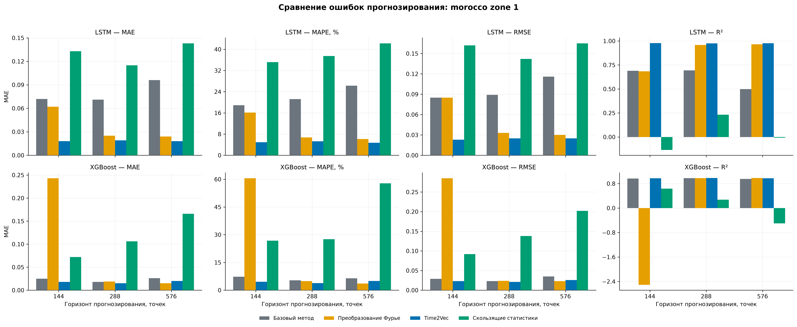
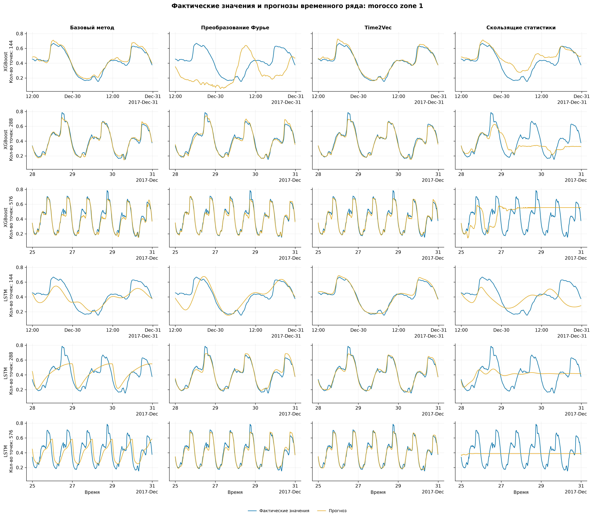
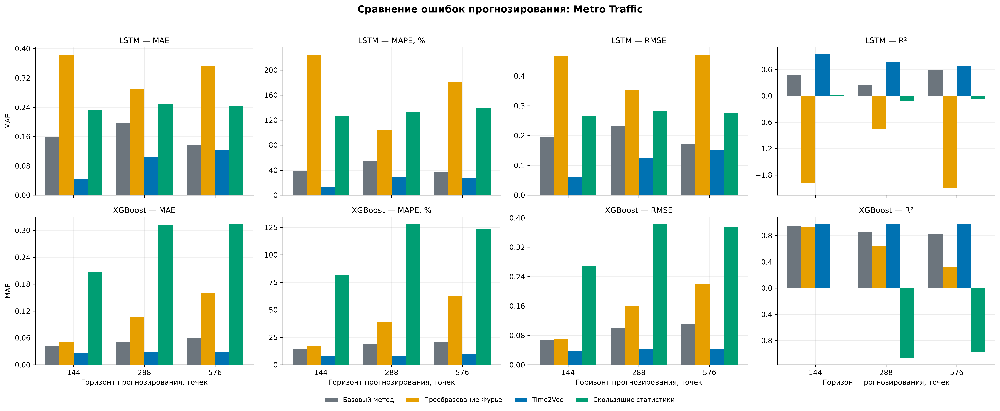
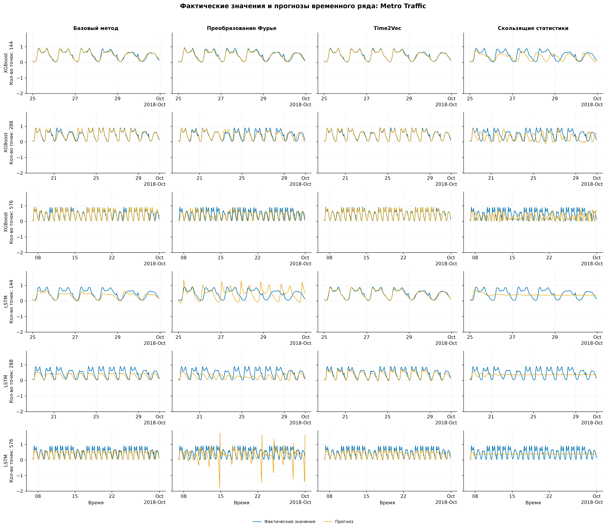
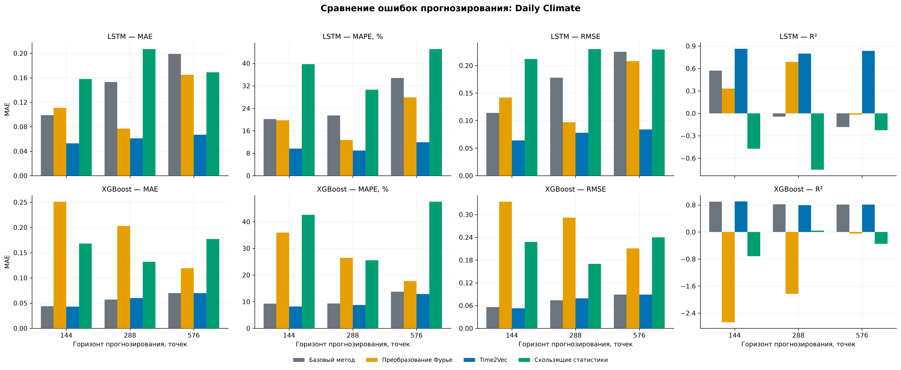
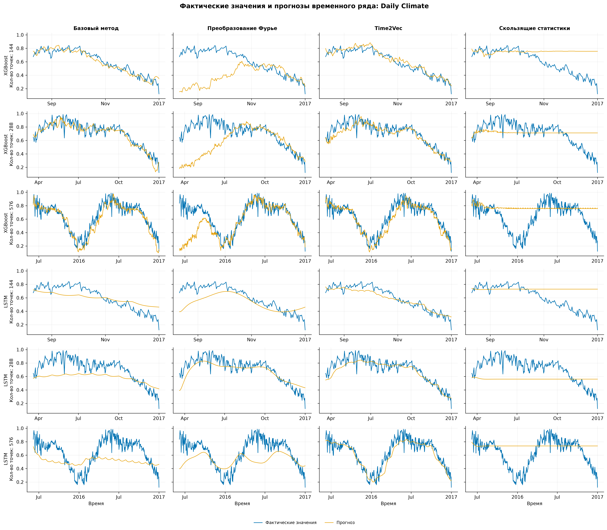
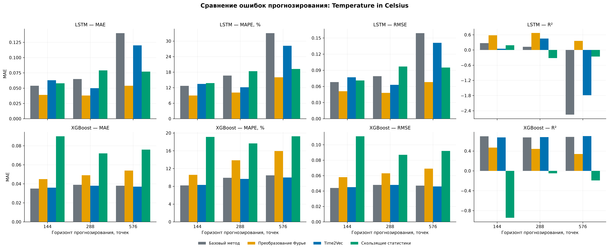
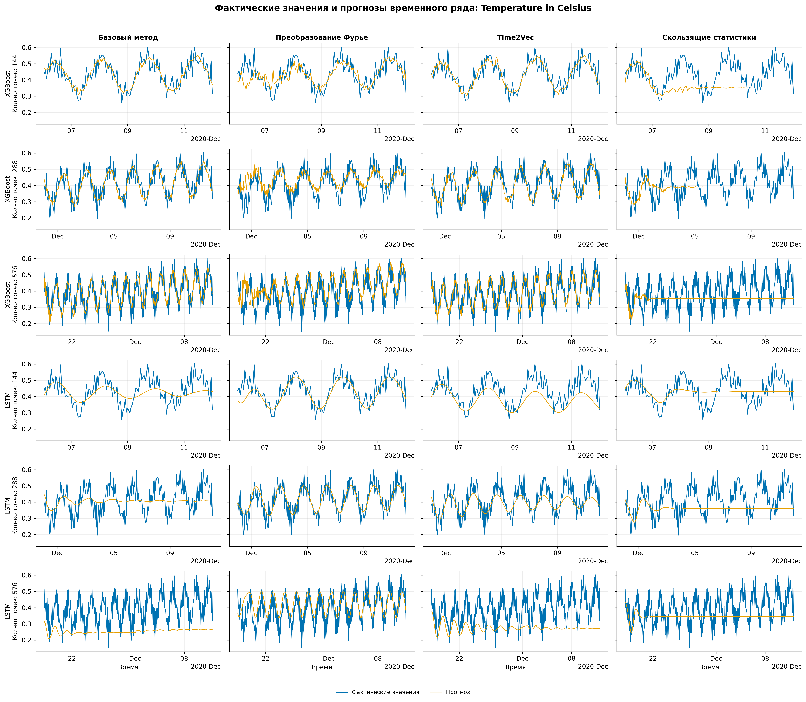

# PFBGB: Pre-Filled Bidirectional Gradient Boosting,


**PFBGB (Pre-Filled Bidirectional Gradient Boosting,)** is an approach for missing value imputation in time series based on gradient boosting with bidirectional training on pre-filled data.

This software was developed by **Nikita Vladimirovich Savvin** as part of a dissertation research project. The presented implementation corresponds to the materials of **Chapter 1** of the dissertation and is intended for conducting computational experiments on missing value imputation in time series.


## Quick Start

### 1. Installing dependencies

```bash
pdm install
```

### 2. Activating the virtual environment

```bash
source .venv/bin/activate
```

### 3. Running experiments

```bash
pdm run src/experiments/main.py
```


<h1 align="center">
Векторно-временное циклическое кодирование временных признаков для прогнозирования временных рядов
</h1>

<div align="center">

<p>
<b>Никита Владимирович Саввин</b><br>
Email: <a href="mailto:savvin.nikita.work@yandex.ru">savvin.nikita.work@yandex.ru</a> &nbsp;&nbsp; ORCID: <a href="https://orcid.org/0009-0009-9163-6234">0009-0009-9163-6234</a>
</p>

</div>

<h2 align="center">Аннотация</h2>

<p align="justify">
Рассматривается задача повышения качества прогнозирования временных рядов за счет эффективного представления временных признаков. Одной из основных проблем существующих подходов является ограниченная информативность традиционных способов кодирования времени, основанных на порядковых или независимых циклических признаках, которые не позволяют в полной мере учитывать взаимосвязь между различными временными компонентами и их периодическую природу.
Предлагается метод векторно-временного циклического кодирования, основанный на совместном представлении временных компонентов в виде единого векторного признакового пространства. Предлагаемый подход формирует компактное циклическое представление временной информации, сохраняющее периодичность календарных признаков и отражающее взаимосвязи между часом, днем, месяцем и другими временными компонентами. Полученное представление может использоваться совместно с моделями машинного обучения без изменения их архитектуры и служит универсальным способом формирования временных признаков для задач прогнозирования.
Экспериментальная оценка на наборах данных, содержащих временные ряды различной природы, показывает, что использование предложенного метода позволяет повысить точность прогнозирования по сравнению с традиционными способами кодирования временных признаков. Полученные результаты подтверждают эффективность векторно-временного циклического представления времени и его применимость при построении моделей прогнозирования временных рядов.
</p>

### Ключевые слова

временные ряды, прогнозирование временных рядов, кодирование временных признаков, циклическое кодирование, векторное представление времени, машинное обучение, календарные признаки, сезонность, периодичность временных рядов, предобработка данных


<h2 align="center">Математическая модель</h2>

$$
Y=(y_1,y_2,\dots,y_T) \tag{1}
$$

где $$y_t$$ — наблюдаемое значение временного ряда в момент времени $$t$$; $$T$$ — количество наблюдений.

Задача прогнозирования временного ряда определяется следующим образом:

$$
\hat{y}_{t+h}=F(X_t,\tau_t)
\tag{2}
$$

где $$X_t$$ — значения временного ряда и дополнительные признаки; $$\tau_t$$ — временная информация о моменте наблюдения; $$F(\cdot)$$ — модель прогнозирования; $$h$$ — горизонт прогноза.</p>

<p align="justify">Одним из ключевых факторов качества прогнозирования является способ представления временной информации. Простое линейное кодирование времени задается следующим образом:</p>

$$
z_t=\tau_t
\tag{3}
$$

где $$z_t$$ — временной признак.

<p align="justify">Однако такое представление не учитывает циклическую природу временных процессов. Близкие состояния периодического цикла могут иметь значительное расстояние в линейном пространстве, что приводит к потере информации о временной структуре.</p>
<p align="justify">Для учета периодичности применяется Fourier-кодирование, основанное на представлении временной информации через набор гармонических компонент:</p>

$$
Z_t=
[
\sin(2\pi f_1t),
\cos(2\pi f_1t),
\dots,
\sin(2\pi f_kt),
\cos(2\pi f_kt)
]
\tag{4}
$$

<p align="justify">где $$f_i$$ — частоты гармонических компонент; $$k$$ — количество выбранных частот.</p>

<p align="justify">Частотные компоненты могут определяться с использованием дискретного преобразования Фурье:</p>

$$
Y_k=
\sum_{t=0}^{T-1}y_t e^{-2\pi i kt/T}
\tag{5}
$$

<p align="justify">где $$Y_k$$ — спектральная компонента временного ряда; $$k$$ — индекс частоты.</p>
<p align="justify">Однако Fourier-кодирование описывает временную структуру преимущественно через частотные зависимости исходного сигнала. Полученные признаки отражают периодические колебания ряда, но не учитывают дополнительные календарные характеристики времени и не формируют единого представления, объединяющего различные временные масштабы.</p>

#### Проблемная ситуция

<p align="justify">Таким образом, возникает проблема построения временного представления, которое одновременно учитывает циклические зависимости и структуру календарного времени. Линейное кодирование приводит к потере периодичности, а Fourier-представление ограничивается выделением отдельных гармонических компонент, не отражающих полную структуру временного состояния.</p>
<p align="justify">Для решения данной проблемы предлагается векторно-временное кодирование, объединяющее циклические, календарные и непрерывные временные признаки в едином пространстве признаков.</p>

## Гипотеза - Векторно-временное циклическое кодирование временных признаков

<p align="justify">
Предполагается, что преобразование временной координаты в многомерное векторное представление, включающее циклические, календарные и непрерывные характеристики времени, позволяет получить более информативное описание временного состояния по сравнению с линейным и Fourier-кодированием.
</p>

<p align="justify">
Временная информация в момент времени $$t$$ представляется набором календарных компонент:
</p>

$$
\tau_t=(year_t,month_t,day_t,week_t,hour_t,minute_t,second_t)
\tag{6}
$$

<p align="justify">
где $$year_t$$, $$month_t$$, $$day_t$$, $$week_t$$ — календарные компоненты даты; $$hour_t$$, $$minute_t$$, $$second_t$$ — временные компоненты момента наблюдения.
</p>

<p align="justify">
Для сохранения циклических зависимостей применяется преобразование:
</p>

$$
C(x,P)=
(
\sin(\frac{2\pi x}{P}),
\cos(\frac{2\pi x}{P})
)
\tag{7}
$$

<p align="justify">
где $$x$$ — временная компонента; $$P$$ — период соответствующего цикла.
</p>

<p align="justify">
На основе циклического преобразования формируются признаки различных временных масштабов:
</p>

$$
H_t=
(
\sin(\frac{2\pi hour_t}{24}),
\cos(\frac{2\pi hour_t}{24})
)
\tag{8}
$$

$$
W_t=
(
\sin(\frac{2\pi week_t}{52}),
\cos(\frac{2\pi week_t}{52})
)
\tag{9}
$$

$$
M_t=
(
\sin(\frac{2\pi month_t}{12}),
\cos(\frac{2\pi month_t}{12})
)
\tag{10}
$$

<p align="justify">
где $$H_t$$ — суточная циклическая компонента; $$W_t$$ — недельная циклическая компонента; $$M_t$$ — годовая циклическая компонента.
</p>

<p align="justify">
Дополнительно формируется набор календарных признаков:
</p>

$$
B_t=(b_1,b_2,\dots,b_n)
\tag{11}
$$

<p align="justify">
где $$b_i$$ — бинарные и категориальные признаки временного состояния: время суток, рабочий день, выходной день, сезон, квартал и другие календарные зависимости.
</p>

<p align="justify">
Для учета долгосрочного изменения временной координаты вводится непрерывный временной тренд:
</p>

$$
R_t=
\frac{t-t_{min}}
{t_{max}-t_{min}}
\tag{12}
$$

<p align="justify">
где $$R_t$$ — нормализованная временная координата.
</p>

<p align="justify">
Итоговое векторное представление времени определяется следующим образом:
</p>

$$
Z_t=
[
\tau_t,
H_t,
W_t,
M_t,
S_t,
Q_t,
B_t,
R_t
]
\tag{13}
$$

<p align="justify">
где $$S_t$$ — сезонное представление; $$Q_t$$ — квартальное представление.
</p>

<p align="justify">
Таким образом, временная координата преобразуется:
</p>

$$
\tau_t \rightarrow Z_t
\tag{14}
$$

<p align="justify">
из одномерного значения в многомерное пространство признаков, содержащее информацию о различных временных масштабах.
</p>

<p align="justify">
Полученное представление используется в модели прогнозирования:
</p>

$$
\hat{y}_{t+h}=F(X_t,Z_t)
\tag{15}
$$

<p align="justify">
где $$Z_t$$ — предложенное векторно-временное представление; $$F(\cdot)$$ — модель прогнозирования.
</p>


<p align="justify">
Предлагаемый подход позволяет устранить ограничения линейного и Fourier-представления за счет совместного учета периодических зависимостей, календарных закономерностей и непрерывного изменения времени в едином пространстве признаков.
</p>

## Программная апробация

<p align="justify">
Программная апробация выполнена на пяти временных рядах различной природы: Russia Amur Region и Morocco Zone 1 — энергетические ряды, Metro Traffic — транспортный поток, Daily Climate и Temperature in Celsius — климатические и температурные наблюдения. В основном эксперименте используются только временная метка и целевая переменная; дополнительные столбцы исходных CSV в прогнозную модель не передаются. Эксперименты проведены для двух моделей — XGBoost [1] и LSTM [2] — и трёх горизонтов: 144, 288 и 576 точек.
</p>

<p align="justify">
Таблица 1 описывает четыре фактически реализованные траектории. В репозитории идентификатор <code>t2v</code> обозначает предложенное векторно-временное циклическое представление. Оно формируется детерминированно из календарной метки и не содержит обучаемых параметров временного встраивания.
</p>

<p align="right"><b>Таблица 1 — Сравниваемые способы формирования временных признаков</b></p>

| Метод | Описание |
| --- | --- |
| Baseline | Базовое временное представление, включающее нормированные календарные признаки: год, месяц, день, час, минуту и секунду. |
| Fourier Encoding | Представление времени через пары синусоидальных и косинусоидальных гармоник. Частоты выбираются по спектру обучающей части: не более шести частот до достижения 95&nbsp;% накопленной мощности. |
| Time2Vec (`t2v`) | Предложенное векторно-временное кодирование, объединяющее календарные, циклические, режимные и непрерывные признаки: день недели, номер недели, синусоиды и косинусоиды часа, недели и месяца, признаки сезона, квартала, времени суток, выходного дня, фазы Луны и временного тренда. Подмножество признаков отбирается Optuna. |
| Rolling Statistics | Статистики предшествующих значений целевого ряда: среднее, стандартное отклонение, минимум, максимум и медиана для трёх окон, построенных от базового лага. Для горизонта используются только значения, доступные до его начала. |

<p align="justify">
Характеристики данных приведены в таблице 2. Перед моделированием код сортирует наблюдения по времени и удаляет дублирующиеся метки. Пропуски целевой переменной в пяти исходных файлах не обнаружены.
</p>

<p align="right"><b>Таблица 2 — Характеристики наборов данных</b></p>

| Набор данных | Тип ряда | Количество исходных точек | Временной интервал | Дискретность |
| --- | --- | ---: | --- | --- |
| Russia Amur Region | Энергетика | 40&nbsp;897 | 01.11.2011–01.07.2016 | 1 час |
| Morocco Zone 1 | Энергетика | 34&nbsp;944 | 01.01.2017–30.12.2017 | 15 минут |
| Metro Traffic | Транспортный поток | 48&nbsp;204 | 02.10.2012–30.09.2018 | 1 час |
| Daily Climate | Средняя температура | 1&nbsp;462 | 01.01.2013–01.01.2017 | 1 сутки |
| Temperature in Celsius | Температура | 183&nbsp;625 | 01.01.2000–12.12.2020 | 1 час |

#### Шаг 1. Определение длины временного окна

<p align="justify">
Для каждой комбинации набора данных, модели и горизонта длина лагового окна определяется по частичной автокорреляционной функции. Выбирается минимальный лаг, на котором накопленная сумма абсолютных PACF достигает 85&nbsp;%; при расчёте рассматриваются лаги до 100. Полученный лаг затем фиксируется для всех четырёх траекторий в одной конфигурации. Такая процедура делает объём исторического контекста общим условием сравнения, а не настраиваемым преимуществом отдельного метода представления времени.
</p>

#### Шаг 2. Настройка базовых моделей прогнозирования

<p align="justify">
Для baseline-настройки выполняется 50 испытаний Optuna [3] с TPE-сэмплером; критерием является максимизация $$R^2$$. Для XGBoost подбираются параметры ансамбля деревьев, для LSTM — размер скрытого слоя, число слоёв, регуляризация, оптимизатор, скорость обучения, размер пакета и число эпох. После настройки параметры baseline используются без изменения во всех траекториях соответствующей группы «набор данных — модель — горизонт».
</p>

<p align="justify">
Это решение необходимо для справедливого сравнения: различия метрик между trajectory не должны объясняться другим лагом, числом деревьев или иной архитектурой LSTM. Проверка файлов параметров эксперимента подтверждает, что для 60 групп «набор данных — модель — горизонт» лаг и словарь параметров совпадают у baseline, Fourier, <code>t2v</code> и rolling statistics. Следовательно, контролируемым фактором является состав временных признаков.
</p>

#### Шаг 3. Применение векторно-временного циклического кодирования временных признаков

<p align="justify">
На третьем этапе исходная временная метка преобразуется в вектор $$Z_t$$, определённый формулами (6)–(15). Для траектории <code>t2v</code> из полного набора календарно-циклических признаков выбирается подмножество с помощью Optuna. В отличие от baseline, модель получает не только линейные календарные компоненты, но и циклическую близость состояний: например, 23:00 и 00:00 становятся близкими в пространстве пары $$\sin/\cos$$. Этот механизм особенно релевантен для внутридневных энергетических и транспортных процессов, в которых одновременно действуют суточные, недельные и сезонные режимы.
</p>

#### Шаг 4. Сравнительный анализ

<p align="justify">
Последние $$H$$ точек ряда образуют хронологический тестовый горизонт. Прогноз строится рекурсивно: очередное предсказание входит в лаговый контекст следующего шага. Качество оценивается по MAE, MAPE, RMSE и $$R^2$$. Меньшие MAE, MAPE и RMSE предпочтительны, большее $$R^2$$ предпочтительно. Целевая переменная в текущей реализации масштабируется в диапазон $$[0,1]$$ до разбиения, поэтому MAE и RMSE приведены в нормированной шкале.
</p>

$$
\operatorname{MAE}=\frac{1}{H}\sum_{i=1}^{H}|y_i-\hat y_i|,\qquad
\operatorname{RMSE}=\sqrt{\frac{1}{H}\sum_{i=1}^{H}(y_i-\hat y_i)^2},
\tag{16}
$$

$$
\operatorname{MAPE}=\frac{100}{H}\sum_{i=1}^{H}
\left|\frac{y_i-\hat y_i}{\max(|y_i|,10^{-8})}\right|,\qquad
R^2=1-\frac{\sum_i(y_i-\hat y_i)^2}{\sum_i(y_i-\bar y)^2}.
\tag{17}
$$

<p align="justify">
Далее для каждого набора данных приведены полная результирующая матрица, график ошибок и сетка фактических и прогнозных рядов. Во всех сетках синяя линия соответствует фактическому ряду, оранжевая — прогнозу; сначала показан XGBoost, затем LSTM. В таблицах каждая метрика представлена в отдельной ячейке, а столбцы сгруппированы по траекториям. Графики используются для содержательной проверки поведения прогноза, а вывод о сравнительном качестве основывается на численных метриках.
</p>

### Russia Amur Region

<p align="justify">
Для энергетического ряда Russia Amur Region <code>t2v</code> обеспечивает лучшие значения в трёх из шести конфигураций по MAE, RMSE и $$R^2$$ и в четырёх по MAPE. На LSTM траектория <code>t2v</code> последовательно превосходит baseline при всех трёх горизонтах. На XGBoost для горизонтов 144 и 576 лучшие значения даёт Fourier-представление, а для горизонта 288 — baseline; поэтому преимущество векторного кодирования для этого ряда является выраженным, но не абсолютным. Детальные метрики представлены в таблице 3, сравнение ошибок — на рисунке 1, а сопоставление фактических и прогнозных значений — на рисунке 2.
</p>

<p align="right"><b>Таблица 3 — Результаты прогнозирования для Russia Amur Region</b></p>

<table>
<thead><tr><th rowspan="2">Модель</th><th rowspan="2">Кол-во точек</th><th colspan="4">t2v</th><th colspan="4">baseline</th><th colspan="4">fourier</th><th colspan="4">rollings_stats</th></tr><tr><th>MAE</th><th>MAPE, %</th><th>RMSE</th><th>R²</th><th>MAE</th><th>MAPE, %</th><th>RMSE</th><th>R²</th><th>MAE</th><th>MAPE, %</th><th>RMSE</th><th>R²</th><th>MAE</th><th>MAPE, %</th><th>RMSE</th><th>R²</th></tr></thead>
<tbody>
<tr><td>LSTM</td><td>144</td><td>0.022</td><td>11.464</td><td>0.028</td><td>0.855</td><td>0.027</td><td>12.400</td><td>0.034</td><td>0.789</td><td>0.037</td><td>22.718</td><td>0.045</td><td>0.621</td><td>0.063</td><td>40.971</td><td>0.080</td><td>-0.188</td></tr>
<tr><td>LSTM</td><td>288</td><td>0.032</td><td>19.822</td><td>0.041</td><td>0.751</td><td>0.042</td><td>26.272</td><td>0.052</td><td>0.598</td><td>0.042</td><td>28.349</td><td>0.051</td><td>0.605</td><td>0.068</td><td>53.710</td><td>0.084</td><td>-0.059</td></tr>
<tr><td>LSTM</td><td>576</td><td>0.039</td><td>20.421</td><td>0.051</td><td>0.658</td><td>0.048</td><td>29.337</td><td>0.060</td><td>0.538</td><td>0.050</td><td>27.845</td><td>0.062</td><td>0.495</td><td>0.072</td><td>50.903</td><td>0.091</td><td>-0.066</td></tr>
<tr><td>XGBoost</td><td>144</td><td>0.029</td><td>13.128</td><td>0.036</td><td>0.753</td><td>0.025</td><td>12.616</td><td>0.032</td><td>0.808</td><td>0.018</td><td>8.833</td><td>0.023</td><td>0.905</td><td>0.102</td><td>55.952</td><td>0.120</td><td>-1.653</td></tr>
<tr><td>XGBoost</td><td>288</td><td>0.029</td><td>16.740</td><td>0.037</td><td>0.796</td><td>0.025</td><td>17.202</td><td>0.033</td><td>0.841</td><td>0.034</td><td>19.453</td><td>0.043</td><td>0.722</td><td>0.068</td><td>31.826</td><td>0.085</td><td>-0.071</td></tr>
<tr><td>XGBoost</td><td>576</td><td>0.037</td><td>18.342</td><td>0.049</td><td>0.691</td><td>0.042</td><td>21.096</td><td>0.053</td><td>0.635</td><td>0.032</td><td>16.344</td><td>0.043</td><td>0.760</td><td>0.048</td><td>29.151</td><td>0.059</td><td>0.547</td></tr>
</tbody></table>

<p align="center"></p>
<p align="center"><b>Рисунок 1.</b> Сравнение ошибок прогнозирования Russia Amur Region.</p>

<p align="center"></p>
<p align="center"><b>Рисунок 2.</b> Фактический ряд и прогнозы Russia Amur Region для всех моделей, горизонтов и траекторий.</p>

### Morocco Zone 1

<p align="justify">
На 15-минутном энергетическом ряде Morocco Zone 1 <code>t2v</code> занимает первое место по всем четырём метрикам в пяти из шести конфигураций. На LSTM преимущество наблюдается при каждом горизонте; на XGBoost исключением является горизонт 576, где Fourier имеет более низкие MAE, MAPE и RMSE. В целом это наиболее последовательный энергетический результат в пользу совместного кодирования календарных масштабов. Детальные метрики представлены в таблице 4, сравнение ошибок — на рисунке 3, а сопоставление фактических и прогнозных значений — на рисунке 4.
</p>

<p align="right"><b>Таблица 4 — Результаты прогнозирования для Morocco Zone 1</b></p>

<table>
<thead><tr><th rowspan="2">Модель</th><th rowspan="2">Кол-во точек</th><th colspan="4">t2v</th><th colspan="4">baseline</th><th colspan="4">fourier</th><th colspan="4">rollings_stats</th></tr><tr><th>MAE</th><th>MAPE, %</th><th>RMSE</th><th>R²</th><th>MAE</th><th>MAPE, %</th><th>RMSE</th><th>R²</th><th>MAE</th><th>MAPE, %</th><th>RMSE</th><th>R²</th><th>MAE</th><th>MAPE, %</th><th>RMSE</th><th>R²</th></tr></thead>
<tbody>
<tr><td>LSTM</td><td>144</td><td>0.018</td><td>4.913</td><td>0.023</td><td>0.978</td><td>0.072</td><td>18.896</td><td>0.085</td><td>0.689</td><td>0.062</td><td>16.153</td><td>0.085</td><td>0.684</td><td>0.133</td><td>35.177</td><td>0.162</td><td>-0.135</td></tr>
<tr><td>LSTM</td><td>288</td><td>0.019</td><td>5.274</td><td>0.025</td><td>0.975</td><td>0.071</td><td>21.194</td><td>0.089</td><td>0.694</td><td>0.025</td><td>6.745</td><td>0.033</td><td>0.959</td><td>0.115</td><td>37.471</td><td>0.142</td><td>0.232</td></tr>
<tr><td>LSTM</td><td>576</td><td>0.018</td><td>4.736</td><td>0.025</td><td>0.977</td><td>0.096</td><td>26.279</td><td>0.116</td><td>0.499</td><td>0.024</td><td>6.146</td><td>0.030</td><td>0.966</td><td>0.143</td><td>42.256</td><td>0.165</td><td>-0.007</td></tr>
<tr><td>XGBoost</td><td>144</td><td>0.018</td><td>4.586</td><td>0.023</td><td>0.976</td><td>0.025</td><td>7.321</td><td>0.029</td><td>0.964</td><td>0.243</td><td>60.547</td><td>0.285</td><td>-2.511</td><td>0.072</td><td>26.811</td><td>0.092</td><td>0.634</td></tr>
<tr><td>XGBoost</td><td>288</td><td>0.015</td><td>3.854</td><td>0.021</td><td>0.983</td><td>0.018</td><td>5.357</td><td>0.023</td><td>0.980</td><td>0.019</td><td>4.937</td><td>0.024</td><td>0.978</td><td>0.106</td><td>27.558</td><td>0.138</td><td>0.272</td></tr>
<tr><td>XGBoost</td><td>576</td><td>0.020</td><td>4.995</td><td>0.026</td><td>0.975</td><td>0.026</td><td>6.439</td><td>0.035</td><td>0.954</td><td>0.015</td><td>3.639</td><td>0.023</td><td>0.981</td><td>0.166</td><td>57.780</td><td>0.202</td><td>-0.500</td></tr>
</tbody></table>

<p align="center"></p>
<p align="center"><b>Рисунок 3.</b> Сравнение ошибок прогнозирования Morocco Zone 1.</p>

<p align="center"></p>
<p align="center"><b>Рисунок 4.</b> Фактический ряд и прогнозы Morocco Zone 1 для всех моделей, горизонтов и траекторий.</p>

### Metro Traffic

<p align="justify">
На транспортном ряде Metro Traffic <code>t2v</code> получает лучший результат по MAE, MAPE, RMSE и $$R^2$$ во всех шести конфигурациях. Преимущество сохраняется и при переходе от 144 к 576 точкам, и для XGBoost, и для LSTM. Такой результат указывает, что многомасштабные календарные признаки особенно полезны для транспортного процесса с выраженным внутрисуточным и недельным режимом. Детальные метрики представлены в таблице 5, сравнение ошибок — на рисунке 5, а сопоставление фактических и прогнозных значений — на рисунке 6.
</p>

<p align="right"><b>Таблица 5 — Результаты прогнозирования для Metro Traffic</b></p>

<table>
<thead><tr><th rowspan="2">Модель</th><th rowspan="2">Кол-во точек</th><th colspan="4">t2v</th><th colspan="4">baseline</th><th colspan="4">fourier</th><th colspan="4">rollings_stats</th></tr><tr><th>MAE</th><th>MAPE, %</th><th>RMSE</th><th>R²</th><th>MAE</th><th>MAPE, %</th><th>RMSE</th><th>R²</th><th>MAE</th><th>MAPE, %</th><th>RMSE</th><th>R²</th><th>MAE</th><th>MAPE, %</th><th>RMSE</th><th>R²</th></tr></thead>
<tbody>
<tr><td>LSTM</td><td>144</td><td>0.043</td><td>13.316</td><td>0.060</td><td>0.950</td><td>0.159</td><td>38.517</td><td>0.196</td><td>0.476</td><td>0.384</td><td>224.880</td><td>0.467</td><td>-1.980</td><td>0.233</td><td>127.045</td><td>0.266</td><td>0.030</td></tr>
<tr><td>LSTM</td><td>288</td><td>0.104</td><td>29.513</td><td>0.126</td><td>0.777</td><td>0.196</td><td>54.955</td><td>0.232</td><td>0.245</td><td>0.291</td><td>104.759</td><td>0.354</td><td>-0.764</td><td>0.249</td><td>132.359</td><td>0.283</td><td>-0.127</td></tr>
<tr><td>LSTM</td><td>576</td><td>0.123</td><td>27.496</td><td>0.150</td><td>0.684</td><td>0.137</td><td>37.532</td><td>0.173</td><td>0.581</td><td>0.353</td><td>181.143</td><td>0.472</td><td>-2.106</td><td>0.243</td><td>138.918</td><td>0.276</td><td>-0.063</td></tr>
<tr><td>XGBoost</td><td>144</td><td>0.025</td><td>8.164</td><td>0.038</td><td>0.980</td><td>0.042</td><td>14.511</td><td>0.066</td><td>0.940</td><td>0.050</td><td>17.327</td><td>0.069</td><td>0.935</td><td>0.206</td><td>81.476</td><td>0.270</td><td>0.001</td></tr>
<tr><td>XGBoost</td><td>288</td><td>0.028</td><td>8.303</td><td>0.042</td><td>0.975</td><td>0.051</td><td>18.421</td><td>0.101</td><td>0.857</td><td>0.106</td><td>38.557</td><td>0.161</td><td>0.637</td><td>0.311</td><td>127.991</td><td>0.383</td><td>-1.067</td></tr>
<tr><td>XGBoost</td><td>576</td><td>0.029</td><td>9.312</td><td>0.043</td><td>0.974</td><td>0.059</td><td>20.715</td><td>0.111</td><td>0.827</td><td>0.160</td><td>62.190</td><td>0.220</td><td>0.322</td><td>0.314</td><td>123.786</td><td>0.376</td><td>-0.972</td></tr>
</tbody></table>

<p align="center"></p>
<p align="center"><b>Рисунок 5.</b> Сравнение ошибок прогнозирования Metro Traffic.</p>

<p align="center"></p>
<p align="center"><b>Рисунок 6.</b> Фактический ряд и прогнозы Metro Traffic для всех моделей, горизонтов и траекторий.</p>

### Daily Climate

<p align="justify">
На Daily Climate траектория <code>t2v</code> имеет минимальный MAPE во всех шести конфигурациях и лучшие MAE, RMSE и $$R^2$$ в четырёх из шести. В двух конфигурациях XGBoost baseline сохраняет небольшое преимущество по абсолютным и квадратичным ошибкам. Следовательно, даже для суточного температурного ряда расширенное представление времени в большинстве условий полезно, но не заменяет проверку альтернативных кодирований. Детальные метрики представлены в таблице 6, сравнение ошибок — на рисунке 7, а сопоставление фактических и прогнозных значений — на рисунке 8.
</p>

<p align="right"><b>Таблица 6 — Результаты прогнозирования для Daily Climate</b></p>

<table>
<thead><tr><th rowspan="2">Модель</th><th rowspan="2">Кол-во точек</th><th colspan="4">t2v</th><th colspan="4">baseline</th><th colspan="4">fourier</th><th colspan="4">rollings_stats</th></tr><tr><th>MAE</th><th>MAPE, %</th><th>RMSE</th><th>R²</th><th>MAE</th><th>MAPE, %</th><th>RMSE</th><th>R²</th><th>MAE</th><th>MAPE, %</th><th>RMSE</th><th>R²</th><th>MAE</th><th>MAPE, %</th><th>RMSE</th><th>R²</th></tr></thead>
<tbody>
<tr><td>LSTM</td><td>144</td><td>0.053</td><td>9.663</td><td>0.064</td><td>0.864</td><td>0.099</td><td>20.162</td><td>0.114</td><td>0.571</td><td>0.111</td><td>19.721</td><td>0.142</td><td>0.333</td><td>0.158</td><td>39.734</td><td>0.212</td><td>-0.473</td></tr>
<tr><td>LSTM</td><td>288</td><td>0.061</td><td>8.939</td><td>0.078</td><td>0.800</td><td>0.153</td><td>21.474</td><td>0.178</td><td>-0.045</td><td>0.077</td><td>12.709</td><td>0.097</td><td>0.688</td><td>0.207</td><td>30.615</td><td>0.230</td><td>-0.753</td></tr>
<tr><td>LSTM</td><td>576</td><td>0.067</td><td>11.939</td><td>0.084</td><td>0.836</td><td>0.199</td><td>34.831</td><td>0.225</td><td>-0.184</td><td>0.165</td><td>27.903</td><td>0.208</td><td>-0.018</td><td>0.169</td><td>45.113</td><td>0.229</td><td>-0.225</td></tr>
<tr><td>XGBoost</td><td>144</td><td>0.043</td><td>8.185</td><td>0.053</td><td>0.907</td><td>0.044</td><td>9.262</td><td>0.056</td><td>0.897</td><td>0.251</td><td>35.910</td><td>0.334</td><td>-2.674</td><td>0.168</td><td>42.576</td><td>0.228</td><td>-0.716</td></tr>
<tr><td>XGBoost</td><td>288</td><td>0.060</td><td>8.779</td><td>0.079</td><td>0.794</td><td>0.057</td><td>9.356</td><td>0.074</td><td>0.821</td><td>0.203</td><td>26.459</td><td>0.292</td><td>-1.831</td><td>0.132</td><td>25.556</td><td>0.170</td><td>0.042</td></tr>
<tr><td>XGBoost</td><td>576</td><td>0.070</td><td>12.888</td><td>0.089</td><td>0.813</td><td>0.070</td><td>13.767</td><td>0.089</td><td>0.815</td><td>0.119</td><td>17.743</td><td>0.211</td><td>-0.045</td><td>0.177</td><td>47.508</td><td>0.240</td><td>-0.351</td></tr>
</tbody></table>

<p align="center"></p>
<p align="center"><b>Рисунок 7.</b> Сравнение ошибок прогнозирования Daily Climate.</p>

<p align="center"></p>
<p align="center"><b>Рисунок 8.</b> Фактический ряд и прогнозы Daily Climate для всех моделей, горизонтов и траекторий.</p>

### Temperature in Celsius

<p align="justify">
На Temperature in Celsius Fourier-представление имеет лучшие значения во всех трёх конфигурациях LSTM, тогда как <code>t2v</code> получает лучший результат в двух из трёх конфигураций XGBoost. В целом Fourier занимает первое место в трёх из шести конфигураций по всем метрикам, <code>t2v</code> — в двух. Этот результат определяет границу применимости предложенного метода: для ряда, где достаточно компактного спектрального описания, частотные признаки могут быть предпочтительнее. Вместе с тем <code>t2v</code> сохраняет преимущество на двух из трёх горизонтов XGBoost, что подтверждает его применимость не только к данным с явным календарным режимом. Детальные метрики представлены в таблице 7, сравнение ошибок — на рисунке 9, а сопоставление фактических и прогнозных значений — на рисунке 10.
</p>

<p align="right"><b>Таблица 7 — Результаты прогнозирования для Temperature in Celsius</b></p>

<table>
<thead><tr><th rowspan="2">Модель</th><th rowspan="2">Кол-во точек</th><th colspan="4">t2v</th><th colspan="4">baseline</th><th colspan="4">fourier</th><th colspan="4">rollings_stats</th></tr><tr><th>MAE</th><th>MAPE, %</th><th>RMSE</th><th>R²</th><th>MAE</th><th>MAPE, %</th><th>RMSE</th><th>R²</th><th>MAE</th><th>MAPE, %</th><th>RMSE</th><th>R²</th><th>MAE</th><th>MAPE, %</th><th>RMSE</th><th>R²</th></tr></thead>
<tbody>
<tr><td>LSTM</td><td>144</td><td>0.063</td><td>13.451</td><td>0.077</td><td>0.051</td><td>0.054</td><td>12.707</td><td>0.068</td><td>0.270</td><td>0.039</td><td>8.983</td><td>0.051</td><td>0.582</td><td>0.058</td><td>13.784</td><td>0.071</td><td>0.187</td></tr>
<tr><td>LSTM</td><td>288</td><td>0.050</td><td>12.169</td><td>0.063</td><td>0.450</td><td>0.065</td><td>16.660</td><td>0.079</td><td>0.126</td><td>0.038</td><td>10.104</td><td>0.048</td><td>0.673</td><td>0.079</td><td>18.379</td><td>0.097</td><td>-0.319</td></tr>
<tr><td>LSTM</td><td>576</td><td>0.120</td><td>28.182</td><td>0.141</td><td>-1.788</td><td>0.140</td><td>33.071</td><td>0.159</td><td>-2.554</td><td>0.054</td><td>16.020</td><td>0.068</td><td>0.359</td><td>0.077</td><td>19.231</td><td>0.095</td><td>-0.259</td></tr>
<tr><td>XGBoost</td><td>144</td><td>0.036</td><td>8.310</td><td>0.045</td><td>0.673</td><td>0.035</td><td>8.200</td><td>0.044</td><td>0.695</td><td>0.045</td><td>10.584</td><td>0.058</td><td>0.469</td><td>0.090</td><td>19.126</td><td>0.111</td><td>-0.944</td></tr>
<tr><td>XGBoost</td><td>288</td><td>0.038</td><td>9.659</td><td>0.048</td><td>0.680</td><td>0.039</td><td>9.913</td><td>0.048</td><td>0.673</td><td>0.049</td><td>13.870</td><td>0.063</td><td>0.442</td><td>0.072</td><td>17.661</td><td>0.087</td><td>-0.050</td></tr>
<tr><td>XGBoost</td><td>576</td><td>0.037</td><td>9.997</td><td>0.046</td><td>0.700</td><td>0.038</td><td>10.470</td><td>0.047</td><td>0.684</td><td>0.054</td><td>15.947</td><td>0.069</td><td>0.339</td><td>0.076</td><td>19.263</td><td>0.092</td><td>-0.192</td></tr>
</tbody></table>

<p align="center"></p>
<p align="center"><b>Рисунок 9.</b> Сравнение ошибок прогнозирования Temperature in Celsius.</p>

<p align="center"></p>
<p align="center"><b>Рисунок 10.</b> Фактический ряд и прогнозы Temperature in Celsius для всех моделей, горизонтов и траекторий.</p>

<p align="justify">
В целом <code>t2v</code> является наиболее результативной траекторией в четырёх из пяти рассмотренных наборов: Russia Amur Region, Morocco Zone 1, Metro Traffic и Daily Climate. Особенно выражен эффект на высокочастотных энергетических и транспортных рядах, где одновременно доступны внутрисуточные, недельные и сезонные режимы. По сравнению с baseline траектория <code>t2v</code> уменьшает MAE в 24 из 30, MAPE в 27 из 30 и RMSE в 23 из 30 конфигураций. Скользящие статистики не занимают первое место ни в одной из 30 конфигураций: для неизвестного горизонта текущая реализация фиксирует статистики на последнем наблюдаемом состоянии и не обновляет их будущими значениями.
</p>

<p align="right"><b>Таблица 8 — Число лучших результатов траектории <code>t2v</code> среди шести конфигураций каждого набора данных</b></p>

| Набор данных | MAE (меньше лучше) | MAPE, % (меньше лучше) | RMSE (меньше лучше) | $$R^2$$ (больше лучше) |
| --- | ---: | ---: | ---: | ---: |
| Russia Amur Region | 3 / 6 | 4 / 6 | 3 / 6 | 3 / 6 |
| Morocco Zone 1 | 5 / 6 | 5 / 6 | 5 / 6 | 5 / 6 |
| Metro Traffic | 6 / 6 | 6 / 6 | 6 / 6 | 6 / 6 |
| Daily Climate | 4 / 6 | 6 / 6 | 4 / 6 | 4 / 6 |
| Temperature in Celsius | 2 / 6 | 2 / 6 | 2 / 6 | 2 / 6 |
| **Всего** | **20 / 30** | **23 / 30** | **20 / 30** | **20 / 30** |

## Обсуждение

<p align="justify">
Таблица 8 показывает, что преимущество <code>t2v</code> связано прежде всего с рядами, в которых временная метка несёт несколько одновременно действующих режимов. Наиболее сильный эффект получен для 15-минутного энергопотребления Morocco Zone 1 и почасового Metro Traffic: в первом случае <code>t2v</code> выигрывает пять из шести конфигураций, во втором — все шесть. Это согласуется с постановкой гипотезы: совместное представление часа, дня недели, номера недели, сезона и тренда позволяет модели различать временные состояния, которые неразличимы при линейном календарном кодировании.
</p>

<p align="justify">
На Russia Amur Region и Daily Climate эффект также преимущественно положителен, но зависит от модели и горизонта. Такое различие не ослабляет основной вывод о полезности <code>t2v</code>, а задаёт его область применимости: метод наиболее целесообразен для рядов с выраженной календарной структурой и несколькими периодическими масштабами. На Temperature in Celsius преимущества Fourier на LSTM показывают, что для ряда с хорошо описываемой спектральной структурой компактное частотное кодирование остаётся сильной альтернативой. Таким образом, <code>t2v</code> следует рассматривать как предпочтительную траекторию для энергетических, транспортных и календарно-зависимых рядов, а Fourier — как важный конкурент для температурных рядов с устойчивой частотной динамикой.
</p>

<p align="justify">
Интерпретация результатов ограничена фиксированной временной отсечкой и отсутствием независимых повторов. Кроме того, текущая реализация масштабирует целевую переменную до разбиения на обучение и тест, а настройка использует последний отрезок ряда. Эти обстоятельства не меняют наблюдаемое ранжирование внутри приведённых таблиц, но требуют повторной проверки на независимых временных происхождениях до формального утверждения статистической значимости. Для следующего цикла экспериментов необходимы временное разбиение «обучение — валидация — тест», настройка преобразований только на обучающей истории, rolling-origin оценка, наивный и сезонно-наивный baseline, а также несколько запусков с фиксированными семенами.
</p>

<!-- [Agent task] BLOCKED: точный снимок исходного кода исторического запуска отсутствует. Текущий main.py вызывает run_split до generate_features, хотя текущая реализация run_split требует уже сформированных признаков; журнал запуска с последовательностью вызовов не найден. -->

## Заключение

<p align="justify">
В работе исследовано влияние векторно-временного циклического кодирования на многошаговое прогнозирование временных рядов моделями XGBoost и LSTM. Предложенная траектория <code>t2v</code> объединяет календарные, циклические, режимные и непрерывные временные признаки и при фиксированных параметрах моделей демонстрирует наибольшее число лучших результатов в четырёх из пяти рассмотренных наборов данных. Наиболее убедительно преимущество проявляется на энергетических и транспортных данных с внутрисуточной и недельной структурой: Morocco Zone 1 и Metro Traffic.
</p>

<p align="justify">
Полученные результаты подтверждают практическую целесообразность включения многомасштабного календарно-циклического представления в признаки авторегрессионных моделей. При этом результат Temperature in Celsius показывает, что метод не является безусловно лучшим для всех типов данных и должен сравниваться с Fourier-признаками. Дальнейшая работа должна подтвердить преимущество <code>t2v</code> в протоколе без утечки, с независимой временной валидацией и несколькими происхождениями прогноза.
</p>

## Литература

1. Chen T., Guestrin C. XGBoost: A Scalable Tree Boosting System // Proceedings of the 22nd ACM SIGKDD International Conference on Knowledge Discovery and Data Mining. 2016. P. 785–794. DOI: [10.1145/2939672.2939785](https://doi.org/10.1145/2939672.2939785).

2. Hochreiter S., Schmidhuber J. Long Short-Term Memory // Neural Computation. 1997. Vol. 9, No. 8. P. 1735–1780. DOI: [10.1162/neco.1997.9.8.1735](https://doi.org/10.1162/neco.1997.9.8.1735).

3. Akiba T., Sano S., Yanase T., Ohta T., Koyama M. Optuna: A Next-generation Hyperparameter Optimization Framework // Proceedings of the 25th ACM SIGKDD International Conference on Knowledge Discovery and Data Mining. 2019. P. 2623–2631. DOI: [10.1145/3292500.3330701](https://doi.org/10.1145/3292500.3330701).
