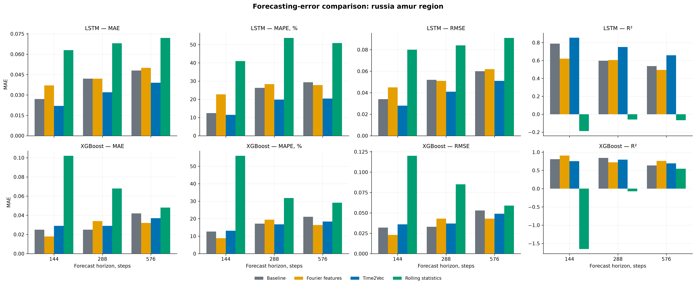
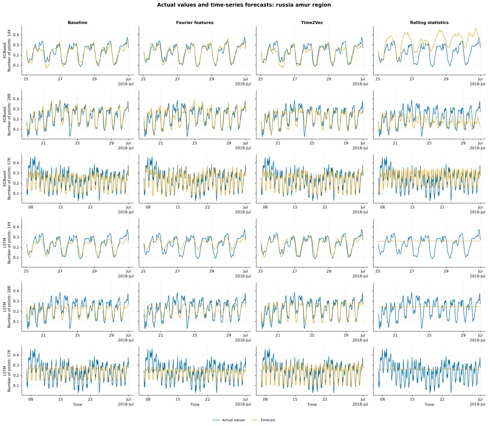
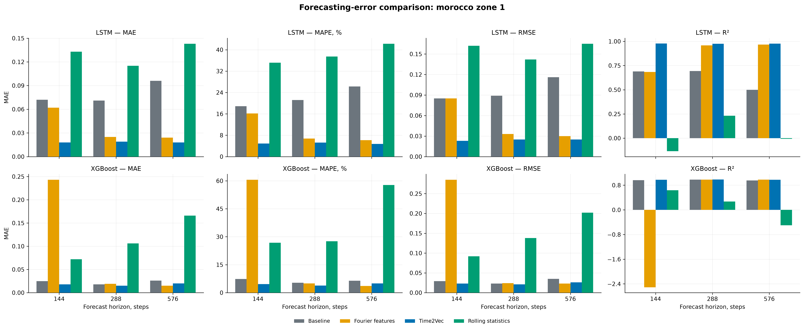
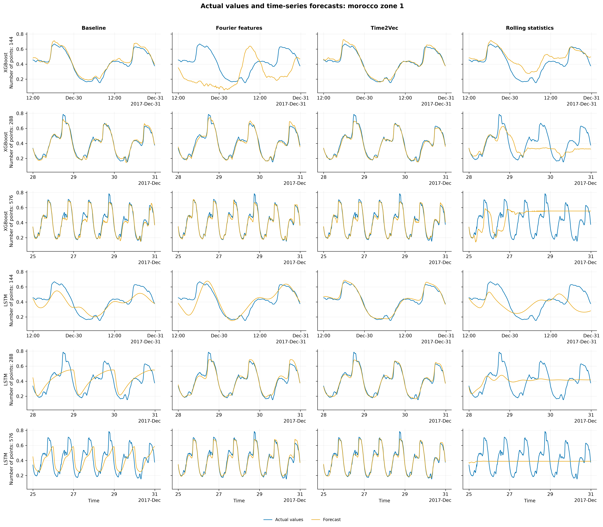
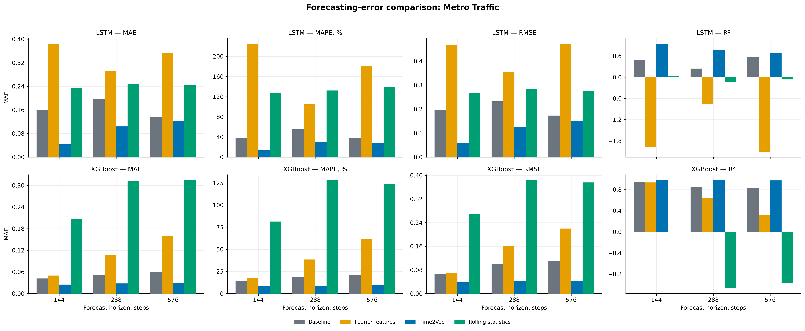
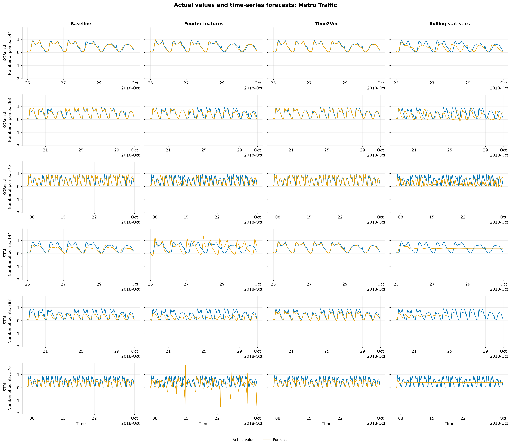
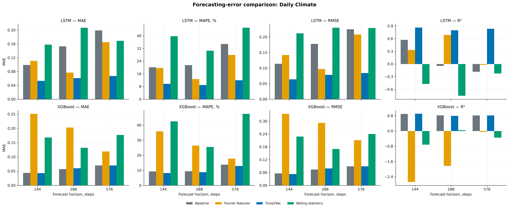
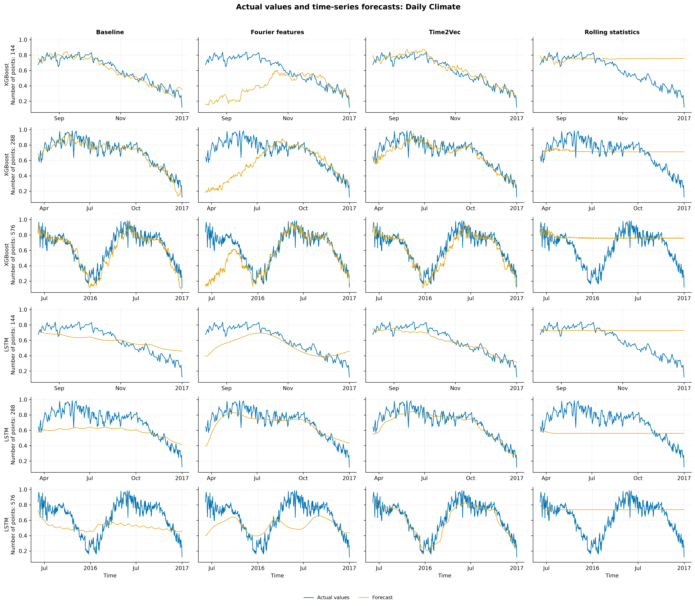
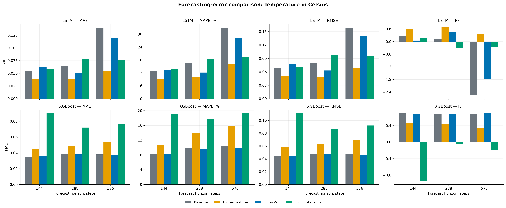
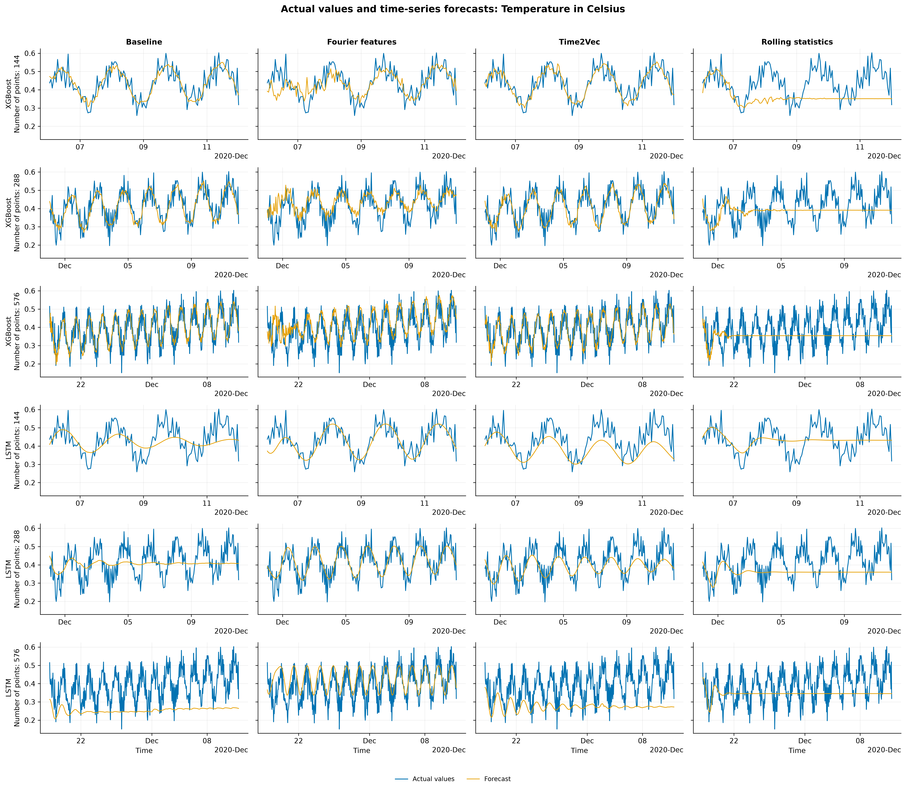

<h1 align="center">
Vector–Temporal Cyclical Encoding of Time Features for Time Series Forecasting
</h1>

<b>Nikita Vladimirovich Savvin</b> 
Email: <a href="mailto:savvin.nikita.work@yandex.ru">savvin.nikita.work@yandex.ru</a> &nbsp;&nbsp; ORCID: <a href="https://orcid.org/0009-0009-9163-6234">0009-0009-9163-6234</a>

<h2 align="center">Abstract</h2>

This study addresses the task of improving time series forecasting accuracy through the effective representation of time features. One of the main limitations of existing approaches is the limited informativeness of conventional time-encoding methods based on ordinal or independent cyclical features, which do not fully account for relationships among distinct temporal components and their periodic nature.
A vector–temporal cyclical encoding method is proposed, based on the joint representation of temporal components in a unified vector feature space. The proposed approach constructs a compact cyclical representation of temporal information that preserves the periodicity of calendar features and captures relationships among the hour, day, month, and other temporal components. The resulting representation can be used with machine-learning models without modifying their architecture and provides a general method for constructing time features in forecasting tasks.
Experimental evaluation on datasets containing time series of different types shows that the proposed method improves forecasting accuracy compared with conventional time-feature encoding methods. The results confirm the effectiveness of the vector–temporal cyclical representation of time and its applicability to building time series forecasting models.

### Keywords

time series, time series forecasting, time-feature encoding, cyclical encoding, vector representation of time, machine learning, calendar features, seasonality, time-series periodicity, data preprocessing

<h2 align="center">Mathematical model</h2>

$$
Y=(y_1,y_2,\dots,y_T) \tag{1}
$$

where $$y_t$$ is the observed time-series value at time $$t$$; $$T$$ is the number of observations.

The time series forecasting task is defined as follows:

$$
\hat{y}_{t+h}=F(X_t,\tau_t)
\tag{2}
$$

where $$X_t$$ denotes time-series values and additional features; $$\tau_t$$ is temporal information about the observation time; $$F(\cdot)$$ is the forecasting model; $$h$$ is the forecast horizon.

One of the key factors affecting forecasting accuracy is the method used to represent temporal information. A simple linear time encoding is defined as follows:

$$
z_t=\tau_t
\tag{3}
$$

where $$z_t$$ is the time feature.

However, this representation does not account for the cyclical nature of temporal processes. Nearby states of a periodic cycle may be far apart in linear space, leading to a loss of information about temporal structure.

To account for periodicity, Fourier encoding is used, representing temporal information through a set of harmonic components:

$$
Z_t=
[
\sin(2\pi f_1t),
\cos(2\pi f_1t),
\dots,
\sin(2\pi f_kt),
\cos(2\pi f_kt)
]
\tag{4}
$$

where $$f_i$$ are the frequencies of harmonic components; $$k$$ is the number of selected frequencies.

Frequency components can be determined using the discrete Fourier transform:

$$
Y_k=
\sum_{t=0}^{T-1}y_t e^{-2\pi i kt/T}
\tag{5}
$$

where $$Y_k$$ is the spectral component of the time series; $$k$$ is the frequency index.

However, Fourier encoding describes temporal structure primarily through frequency dependencies of the original signal. The resulting features reflect periodic fluctuations in the series but do not account for additional calendar characteristics of time and do not form a unified representation that combines different temporal scales.

#### Problem statement

Thus, the problem arises of constructing a temporal representation that simultaneously accounts for cyclical dependencies and the structure of calendar time. Linear encoding leads to a loss of periodicity, while the Fourier representation is limited to extracting individual harmonic components and does not reflect the complete structure of the temporal state.

To address this problem, vector–temporal encoding is proposed, combining cyclical, calendar, and continuous time features in a unified feature space.

## Hypothesis — vector–temporal cyclical encoding of time features

It is assumed that transforming the time coordinate into a multidimensional vector representation that includes cyclical, calendar, and continuous characteristics of time provides a more informative description of the temporal state than linear and Fourier encoding.

Temporal information at time $$t$$ is represented by a set of calendar components:

$$
\tau_t=(year_t,month_t,day_t,week_t,hour_t,minute_t,second_t)
\tag{6}
$$

where $$year_t$$, $$month_t$$, $$day_t$$, $$week_t$$ are calendar date components; $$hour_t$$, $$minute_t$$, $$second_t$$ are components of the observation time.

The following transformation is used to preserve cyclical dependencies:

$$
C(x,P)=
(
\sin(\frac{2\pi x}{P}),
\cos(\frac{2\pi x}{P})
)
\tag{7}
$$

where $$x$$ is a temporal component; $$P$$ is the period of the corresponding cycle.

Based on the cyclical transformation, features at different temporal scales are constructed:

$$
H_t=
(
\sin(\frac{2\pi hour_t}{24}),
\cos(\frac{2\pi hour_t}{24})
)
\tag{8}
$$

$$
W_t=
(
\sin(\frac{2\pi week_t}{52}),
\cos(\frac{2\pi week_t}{52})
)
\tag{9}
$$

$$
M_t=
(
\sin(\frac{2\pi month_t}{12}),
\cos(\frac{2\pi month_t}{12})
)
\tag{10}
$$

where $$H_t$$ is the daily cyclical component; $$W_t$$ is the weekly cyclical component; $$M_t$$ is the annual cyclical component.

Additionally, a set of calendar features is constructed:

$$
B_t=(b_1,b_2,\dots,b_n)
\tag{11}
$$

where $$b_i$$ are binary and categorical features of the temporal state: time of day, working day, weekend, season, quarter, and other calendar dependencies.

To account for long-term variation in the time coordinate, a continuous time trend is introduced:

$$
R_t=
\frac{t-t_{min}}
{t_{max}-t_{min}}
\tag{12}
$$

where $$R_t$$ is the normalized time coordinate.

The final vector representation of time is defined as follows:

$$
Z_t=
[
\tau_t,
H_t,
W_t,
M_t,
S_t,
Q_t,
B_t,
R_t
]
\tag{13}
$$

where $$S_t$$ is the seasonal representation; $$Q_t$$ is the quarterly representation.

Thus, the time coordinate is transformed:

$$
\tau_t \rightarrow Z_t
\tag{14}
$$

from a one-dimensional value into a multidimensional feature space containing information at different temporal scales.

The resulting representation is used in the forecasting model:

$$
\hat{y}_{t+h}=F(X_t,Z_t)
\tag{15}
$$

where $$Z_t$$ is the proposed vector–temporal representation; $$F(\cdot)$$ is the forecasting model.

The proposed approach overcomes the limitations of linear and Fourier representations by jointly accounting for periodic dependencies, calendar patterns, and continuous changes in time within a unified feature space.

## Software evaluation

The software evaluation was performed on five time series of different types: Russia Amur Region and Morocco Zone 1 are energy series, Metro Traffic is a traffic-flow series, and Daily Climate and Temperature in Celsius are climate and temperature observations. The main experiment uses only the timestamp and the target variable; additional columns from the original CSV files are not passed to the forecasting model. Experiments were conducted for two models—XGBoost [1] and LSTM [2]—and three horizons: 144, 288, and 576 points.

Table 1 describes the four implementations actually evaluated. In the repository, the identifier <code>t2v</code> denotes the proposed vector–temporal cyclical representation. It is deterministically constructed from the calendar timestamp and contains no trainable temporal-embedding parameters.

<b>Table 1 — Compared methods for constructing time features</b>

| Method | Description |
| --- | --- |
| Baseline | A basic temporal representation comprising normalized calendar features: year, month, day, hour, minute, and second. |
| Fourier Encoding | A representation of time through pairs of sinusoidal and cosine harmonics. Frequencies are selected from the spectrum of the training portion: at most six frequencies until 95&nbsp;% cumulative power is reached. |
| Time2Vec (`t2v`) | The proposed vector–temporal encoding that combines calendar, cyclical, regime, and continuous features: day of week, week number, sine and cosine of the hour, week, and month, as well as features of season, quarter, time of day, weekend, lunar phase, and time trend. A subset of features is selected by Optuna. |
| Rolling Statistics | Statistics of preceding target-series values: mean, standard deviation, minimum, maximum, and median for three windows derived from the base lag. Only values available before the beginning of the horizon are used. |

The data characteristics are given in Table 2. Before modeling, the code sorts observations by time and removes duplicate timestamps. No missing target-variable values were found in the five source files.

<b>Table 2 — Dataset characteristics</b>

| Dataset | Series type | Number of source points | Time interval | Resolution |
| --- | --- | ---: | --- | --- |
| Russia Amur Region | Energy | 40&nbsp;897 | 01.11.2011–01.07.2016 | 1 hour |
| Morocco Zone 1 | Energy | 34&nbsp;944 | 01.01.2017–30.12.2017 | 15 minutes |
| Metro Traffic | Traffic flow | 48&nbsp;204 | 02.10.2012–30.09.2018 | 1 hour |
| Daily Climate | Mean temperature | 1&nbsp;462 | 01.01.2013–01.01.2017 | 1 day |
| Temperature in Celsius | Temperature | 183&nbsp;625 | 01.01.2000–12.12.2020 | 1 hour |

#### Step 1. Determining the time-window length

For each combination of dataset, model, and horizon, the lag-window length is determined using the partial autocorrelation function. The minimum lag at which the cumulative sum of absolute PACF values reaches 85&nbsp;% is selected; lags up to 100 are considered. The resulting lag is then fixed for all four approaches within a configuration. This procedure makes the amount of historical context a common condition of comparison rather than a tunable advantage of a particular time-representation method.

#### Step 2. Tuning the baseline forecasting models

For baseline tuning, 50 Optuna [3] trials are performed with a TPE sampler; the criterion is maximizing $$R^2$$. For XGBoost, tree-ensemble parameters are optimized; for LSTM, the hidden-layer size, number of layers, regularization, optimizer, learning rate, batch size, and number of epochs are optimized. After tuning, the baseline parameters are used unchanged across all approaches in the corresponding “dataset—model—horizon” group.

This decision is necessary for a fair comparison: differences in metrics among approaches should not be explained by another lag, number of trees, or a different LSTM architecture. Inspection of the experiment parameter files confirms that, for 60 “dataset—model—horizon” groups, the lag and parameter dictionary are identical for baseline, Fourier, <code>t2v</code>, and rolling statistics. Therefore, the composition of time features is the controlled factor.

#### Step 3. Applying vector–temporal cyclical encoding of time features

At the third stage, the original timestamp is transformed into the vector $$Z_t$$ defined by formulas (6)–(15). For the <code>t2v</code> approach, a subset is selected from the full set of calendar-cyclical features using Optuna. Unlike the baseline, the model receives not only linear calendar components but also cyclical proximity of states: for example, 23:00 and 00:00 become close in the space of the $$\sin/\cos$$ pair. This mechanism is especially relevant to intraday energy and transport processes in which daily, weekly, and seasonal regimes operate simultaneously.

#### Step 4. Comparative analysis

The last $$H$$ points of the series form the chronological test horizon. Forecasting is recursive: each prediction enters the lagged context of the next step. Performance is evaluated using MAE, MAPE, RMSE, and $$R^2$$. Lower MAE, MAPE, and RMSE values are preferred, whereas a higher $$R^2$$ is preferred. In the current implementation, the target variable is scaled to the $$[0,1]$$ range before splitting; therefore, MAE and RMSE are reported on a normalized scale.

$$
MAE=\frac{1}{H}\sum_{i=1}^{H}|y_i-\hat y_i|,\qquad
RMSE=\sqrt{\frac{1}{H}\sum_{i=1}^{H}(y_i-\hat y_i)^2},
\tag{16}
$$

$$
MAPE=\frac{100}{H}\sum_{i=1}^{H}
\left|\frac{y_i-\hat y_i}{\max(|y_i|,10^{-8})}\right|,\qquad
R^2=1-\frac{\sum_i(y_i-\hat y_i)^2}{\sum_i(y_i-\bar y)^2}.
\tag{17}
$$

For each dataset, the complete result matrix, error plot, and grid of actual and forecast series are presented below. In all grids, the blue line represents the actual series and the orange line the forecast; XGBoost is shown first, followed by LSTM. In the tables, each metric is shown in a separate cell, and columns are grouped by approach. The plots are used to assess forecast behavior substantively, while conclusions about comparative performance are based on numerical metrics.

### Russia Amur Region

For the Russia Amur Region energy series, <code>t2v</code> provides the best MAE, RMSE, and $$R^2$$ values in three of six configurations and the best MAPE in four. For LSTM, the <code>t2v</code> approach consistently outperforms the baseline at all three horizons. For XGBoost, the Fourier representation gives the best values at horizons 144 and 576, while the baseline does so at horizon 288; therefore, the advantage of vector encoding for this series is pronounced but not absolute. Detailed metrics are presented in Table 3, error comparison in Figure 1, and comparison of actual and forecast values in Figure 2.

<b>Table 3 — Forecasting results for Russia Amur Region</b>

<table>
<thead><tr><th rowspan="2">Model</th><th rowspan="2">Number of points</th><th colspan="4">t2v</th><th colspan="4">baseline</th><th colspan="4">fourier</th><th colspan="4">rollings_stats</th></tr><tr><th>MAE</th><th>MAPE, %</th><th>RMSE</th><th>R²</th><th>MAE</th><th>MAPE, %</th><th>RMSE</th><th>R²</th><th>MAE</th><th>MAPE, %</th><th>RMSE</th><th>R²</th><th>MAE</th><th>MAPE, %</th><th>RMSE</th><th>R²</th></tr></thead>
<tbody>
<tr><td>LSTM</td><td>144</td><td>0.022</td><td>11.464</td><td>0.028</td><td>0.855</td><td>0.027</td><td>12.400</td><td>0.034</td><td>0.789</td><td>0.037</td><td>22.718</td><td>0.045</td><td>0.621</td><td>0.063</td><td>40.971</td><td>0.080</td><td>-0.188</td></tr>
<tr><td>LSTM</td><td>288</td><td>0.032</td><td>19.822</td><td>0.041</td><td>0.751</td><td>0.042</td><td>26.272</td><td>0.052</td><td>0.598</td><td>0.042</td><td>28.349</td><td>0.051</td><td>0.605</td><td>0.068</td><td>53.710</td><td>0.084</td><td>-0.059</td></tr>
<tr><td>LSTM</td><td>576</td><td>0.039</td><td>20.421</td><td>0.051</td><td>0.658</td><td>0.048</td><td>29.337</td><td>0.060</td><td>0.538</td><td>0.050</td><td>27.845</td><td>0.062</td><td>0.495</td><td>0.072</td><td>50.903</td><td>0.091</td><td>-0.066</td></tr>
<tr><td>XGBoost</td><td>144</td><td>0.029</td><td>13.128</td><td>0.036</td><td>0.753</td><td>0.025</td><td>12.616</td><td>0.032</td><td>0.808</td><td>0.018</td><td>8.833</td><td>0.023</td><td>0.905</td><td>0.102</td><td>55.952</td><td>0.120</td><td>-1.653</td></tr>
<tr><td>XGBoost</td><td>288</td><td>0.029</td><td>16.740</td><td>0.037</td><td>0.796</td><td>0.025</td><td>17.202</td><td>0.033</td><td>0.841</td><td>0.034</td><td>19.453</td><td>0.043</td><td>0.722</td><td>0.068</td><td>31.826</td><td>0.085</td><td>-0.071</td></tr>
<tr><td>XGBoost</td><td>576</td><td>0.037</td><td>18.342</td><td>0.049</td><td>0.691</td><td>0.042</td><td>21.096</td><td>0.053</td><td>0.635</td><td>0.032</td><td>16.344</td><td>0.043</td><td>0.760</td><td>0.048</td><td>29.151</td><td>0.059</td><td>0.547</td></tr>
</tbody></table>

<b>Figure 1.</b> Forecasting error comparison for Russia Amur Region.

<b>Figure 2.</b> Actual series and forecasts for Russia Amur Region across all models, horizons, and approaches.

### Morocco Zone 1

For the 15-minute Morocco Zone 1 energy series, <code>t2v</code> ranks first on all four metrics in five of six configurations. For LSTM, the advantage is observed at every horizon; for XGBoost, the exception is horizon 576, where Fourier has lower MAE, MAPE, and RMSE. Overall, this is the most consistent energy result in favor of jointly encoding calendar scales. Detailed metrics are presented in Table 4, error comparison in Figure 3, and comparison of actual and forecast values in Figure 4.

<b>Table 4 — Forecasting results for Morocco Zone 1</b>

<table>
<thead><tr><th rowspan="2">Model</th><th rowspan="2">Number of points</th><th colspan="4">t2v</th><th colspan="4">baseline</th><th colspan="4">fourier</th><th colspan="4">rollings_stats</th></tr><tr><th>MAE</th><th>MAPE, %</th><th>RMSE</th><th>R²</th><th>MAE</th><th>MAPE, %</th><th>RMSE</th><th>R²</th><th>MAE</th><th>MAPE, %</th><th>RMSE</th><th>R²</th><th>MAE</th><th>MAPE, %</th><th>RMSE</th><th>R²</th></tr></thead>
<tbody>
<tr><td>LSTM</td><td>144</td><td>0.018</td><td>4.913</td><td>0.023</td><td>0.978</td><td>0.072</td><td>18.896</td><td>0.085</td><td>0.689</td><td>0.062</td><td>16.153</td><td>0.085</td><td>0.684</td><td>0.133</td><td>35.177</td><td>0.162</td><td>-0.135</td></tr>
<tr><td>LSTM</td><td>288</td><td>0.019</td><td>5.274</td><td>0.025</td><td>0.975</td><td>0.071</td><td>21.194</td><td>0.089</td><td>0.694</td><td>0.025</td><td>6.745</td><td>0.033</td><td>0.959</td><td>0.115</td><td>37.471</td><td>0.142</td><td>0.232</td></tr>
<tr><td>LSTM</td><td>576</td><td>0.018</td><td>4.736</td><td>0.025</td><td>0.977</td><td>0.096</td><td>26.279</td><td>0.116</td><td>0.499</td><td>0.024</td><td>6.146</td><td>0.030</td><td>0.966</td><td>0.143</td><td>42.256</td><td>0.165</td><td>-0.007</td></tr>
<tr><td>XGBoost</td><td>144</td><td>0.018</td><td>4.586</td><td>0.023</td><td>0.976</td><td>0.025</td><td>7.321</td><td>0.029</td><td>0.964</td><td>0.243</td><td>60.547</td><td>0.285</td><td>-2.511</td><td>0.072</td><td>26.811</td><td>0.092</td><td>0.634</td></tr>
<tr><td>XGBoost</td><td>288</td><td>0.015</td><td>3.854</td><td>0.021</td><td>0.983</td><td>0.018</td><td>5.357</td><td>0.023</td><td>0.980</td><td>0.019</td><td>4.937</td><td>0.024</td><td>0.978</td><td>0.106</td><td>27.558</td><td>0.138</td><td>0.272</td></tr>
<tr><td>XGBoost</td><td>576</td><td>0.020</td><td>4.995</td><td>0.026</td><td>0.975</td><td>0.026</td><td>6.439</td><td>0.035</td><td>0.954</td><td>0.015</td><td>3.639</td><td>0.023</td><td>0.981</td><td>0.166</td><td>57.780</td><td>0.202</td><td>-0.500</td></tr>
</tbody></table>

<b>Figure 3.</b> Forecasting error comparison for Morocco Zone 1.

<b>Figure 4.</b> Actual series and forecasts for Morocco Zone 1 across all models, horizons, and approaches.

### Metro Traffic

For the Metro Traffic series, <code>t2v</code> achieves the best MAE, MAPE, RMSE, and $$R^2$$ values in all six configurations. The advantage remains when moving from 144 to 576 points and for both XGBoost and LSTM. This result indicates that multiscale calendar features are particularly useful for a traffic process with pronounced intraday and weekly regimes. Detailed metrics are presented in Table 5, error comparison in Figure 5, and comparison of actual and forecast values in Figure 6.

<b>Table 5 — Forecasting results for Metro Traffic</b>

<table>
<thead><tr><th rowspan="2">Model</th><th rowspan="2">Number of points</th><th colspan="4">t2v</th><th colspan="4">baseline</th><th colspan="4">fourier</th><th colspan="4">rollings_stats</th></tr><tr><th>MAE</th><th>MAPE, %</th><th>RMSE</th><th>R²</th><th>MAE</th><th>MAPE, %</th><th>RMSE</th><th>R²</th><th>MAE</th><th>MAPE, %</th><th>RMSE</th><th>R²</th><th>MAE</th><th>MAPE, %</th><th>RMSE</th><th>R²</th></tr></thead>
<tbody>
<tr><td>LSTM</td><td>144</td><td>0.043</td><td>13.316</td><td>0.060</td><td>0.950</td><td>0.159</td><td>38.517</td><td>0.196</td><td>0.476</td><td>0.384</td><td>224.880</td><td>0.467</td><td>-1.980</td><td>0.233</td><td>127.045</td><td>0.266</td><td>0.030</td></tr>
<tr><td>LSTM</td><td>288</td><td>0.104</td><td>29.513</td><td>0.126</td><td>0.777</td><td>0.196</td><td>54.955</td><td>0.232</td><td>0.245</td><td>0.291</td><td>104.759</td><td>0.354</td><td>-0.764</td><td>0.249</td><td>132.359</td><td>0.283</td><td>-0.127</td></tr>
<tr><td>LSTM</td><td>576</td><td>0.123</td><td>27.496</td><td>0.150</td><td>0.684</td><td>0.137</td><td>37.532</td><td>0.173</td><td>0.581</td><td>0.353</td><td>181.143</td><td>0.472</td><td>-2.106</td><td>0.243</td><td>138.918</td><td>0.276</td><td>-0.063</td></tr>
<tr><td>XGBoost</td><td>144</td><td>0.025</td><td>8.164</td><td>0.038</td><td>0.980</td><td>0.042</td><td>14.511</td><td>0.066</td><td>0.940</td><td>0.050</td><td>17.327</td><td>0.069</td><td>0.935</td><td>0.206</td><td>81.476</td><td>0.270</td><td>0.001</td></tr>
<tr><td>XGBoost</td><td>288</td><td>0.028</td><td>8.303</td><td>0.042</td><td>0.975</td><td>0.051</td><td>18.421</td><td>0.101</td><td>0.857</td><td>0.106</td><td>38.557</td><td>0.161</td><td>0.637</td><td>0.311</td><td>127.991</td><td>0.383</td><td>-1.067</td></tr>
<tr><td>XGBoost</td><td>576</td><td>0.029</td><td>9.312</td><td>0.043</td><td>0.974</td><td>0.059</td><td>20.715</td><td>0.111</td><td>0.827</td><td>0.160</td><td>62.190</td><td>0.220</td><td>0.322</td><td>0.314</td><td>123.786</td><td>0.376</td><td>-0.972</td></tr>
</tbody></table>

<b>Figure 5.</b> Forecasting error comparison for Metro Traffic.

<b>Figure 6.</b> Actual series and forecasts for Metro Traffic across all models, horizons, and approaches.

### Daily Climate

For Daily Climate, the <code>t2v</code> approach has the lowest MAPE in all six configurations and the best MAE, RMSE, and $$R^2$$ in four of six. In two XGBoost configurations, the baseline retains a slight advantage in absolute and squared errors. Therefore, even for a daily temperature series, the extended time representation is useful in most settings but does not replace testing alternative encodings. Detailed metrics are presented in Table 6, error comparison in Figure 7, and comparison of actual and forecast values in Figure 8.

<b>Table 6 — Forecasting results for Daily Climate</b>

<table>
<thead><tr><th rowspan="2">Model</th><th rowspan="2">Number of points</th><th colspan="4">t2v</th><th colspan="4">baseline</th><th colspan="4">fourier</th><th colspan="4">rollings_stats</th></tr><tr><th>MAE</th><th>MAPE, %</th><th>RMSE</th><th>R²</th><th>MAE</th><th>MAPE, %</th><th>RMSE</th><th>R²</th><th>MAE</th><th>MAPE, %</th><th>RMSE</th><th>R²</th><th>MAE</th><th>MAPE, %</th><th>RMSE</th><th>R²</th></tr></thead>
<tbody>
<tr><td>LSTM</td><td>144</td><td>0.053</td><td>9.663</td><td>0.064</td><td>0.864</td><td>0.099</td><td>20.162</td><td>0.114</td><td>0.571</td><td>0.111</td><td>19.721</td><td>0.142</td><td>0.333</td><td>0.158</td><td>39.734</td><td>0.212</td><td>-0.473</td></tr>
<tr><td>LSTM</td><td>288</td><td>0.061</td><td>8.939</td><td>0.078</td><td>0.800</td><td>0.153</td><td>21.474</td><td>0.178</td><td>-0.045</td><td>0.077</td><td>12.709</td><td>0.097</td><td>0.688</td><td>0.207</td><td>30.615</td><td>0.230</td><td>-0.753</td></tr>
<tr><td>LSTM</td><td>576</td><td>0.067</td><td>11.939</td><td>0.084</td><td>0.836</td><td>0.199</td><td>34.831</td><td>0.225</td><td>-0.184</td><td>0.165</td><td>27.903</td><td>0.208</td><td>-0.018</td><td>0.169</td><td>45.113</td><td>0.229</td><td>-0.225</td></tr>
<tr><td>XGBoost</td><td>144</td><td>0.043</td><td>8.185</td><td>0.053</td><td>0.907</td><td>0.044</td><td>9.262</td><td>0.056</td><td>0.897</td><td>0.251</td><td>35.910</td><td>0.334</td><td>-2.674</td><td>0.168</td><td>42.576</td><td>0.228</td><td>-0.716</td></tr>
<tr><td>XGBoost</td><td>288</td><td>0.060</td><td>8.779</td><td>0.079</td><td>0.794</td><td>0.057</td><td>9.356</td><td>0.074</td><td>0.821</td><td>0.203</td><td>26.459</td><td>0.292</td><td>-1.831</td><td>0.132</td><td>25.556</td><td>0.170</td><td>0.042</td></tr>
<tr><td>XGBoost</td><td>576</td><td>0.070</td><td>12.888</td><td>0.089</td><td>0.813</td><td>0.070</td><td>13.767</td><td>0.089</td><td>0.815</td><td>0.119</td><td>17.743</td><td>0.211</td><td>-0.045</td><td>0.177</td><td>47.508</td><td>0.240</td><td>-0.351</td></tr>
</tbody></table>

<b>Figure 7.</b> Forecasting error comparison for Daily Climate.

<b>Figure 8.</b> Actual series and forecasts for Daily Climate across all models, horizons, and approaches.

### Temperature in Celsius

For Temperature in Celsius, the Fourier representation achieves the best values in all three LSTM configurations, whereas <code>t2v</code> achieves the best result in two of three XGBoost configurations. Overall, Fourier ranks first in three of six configurations on all metrics, and <code>t2v</code> in two. This result defines a boundary of applicability for the proposed method: for a series adequately described by a compact spectral representation, frequency features may be preferable. At the same time, <code>t2v</code> retains an advantage at two of the three XGBoost horizons, confirming its applicability beyond data with an explicit calendar regime. Detailed metrics are presented in Table 7, error comparison in Figure 9, and comparison of actual and forecast values in Figure 10.

<b>Table 7 — Forecasting results for Temperature in Celsius</b>

<table>
<thead><tr><th rowspan="2">Model</th><th rowspan="2">Number of points</th><th colspan="4">t2v</th><th colspan="4">baseline</th><th colspan="4">fourier</th><th colspan="4">rollings_stats</th></tr><tr><th>MAE</th><th>MAPE, %</th><th>RMSE</th><th>R²</th><th>MAE</th><th>MAPE, %</th><th>RMSE</th><th>R²</th><th>MAE</th><th>MAPE, %</th><th>RMSE</th><th>R²</th><th>MAE</th><th>MAPE, %</th><th>RMSE</th><th>R²</th></tr></thead>
<tbody>
<tr><td>LSTM</td><td>144</td><td>0.063</td><td>13.451</td><td>0.077</td><td>0.051</td><td>0.054</td><td>12.707</td><td>0.068</td><td>0.270</td><td>0.039</td><td>8.983</td><td>0.051</td><td>0.582</td><td>0.058</td><td>13.784</td><td>0.071</td><td>0.187</td></tr>
<tr><td>LSTM</td><td>288</td><td>0.050</td><td>12.169</td><td>0.063</td><td>0.450</td><td>0.065</td><td>16.660</td><td>0.079</td><td>0.126</td><td>0.038</td><td>10.104</td><td>0.048</td><td>0.673</td><td>0.079</td><td>18.379</td><td>0.097</td><td>-0.319</td></tr>
<tr><td>LSTM</td><td>576</td><td>0.120</td><td>28.182</td><td>0.141</td><td>-1.788</td><td>0.140</td><td>33.071</td><td>0.159</td><td>-2.554</td><td>0.054</td><td>16.020</td><td>0.068</td><td>0.359</td><td>0.077</td><td>19.231</td><td>0.095</td><td>-0.259</td></tr>
<tr><td>XGBoost</td><td>144</td><td>0.036</td><td>8.310</td><td>0.045</td><td>0.673</td><td>0.035</td><td>8.200</td><td>0.044</td><td>0.695</td><td>0.045</td><td>10.584</td><td>0.058</td><td>0.469</td><td>0.090</td><td>19.126</td><td>0.111</td><td>-0.944</td></tr>
<tr><td>XGBoost</td><td>288</td><td>0.038</td><td>9.659</td><td>0.048</td><td>0.680</td><td>0.039</td><td>9.913</td><td>0.048</td><td>0.673</td><td>0.049</td><td>13.870</td><td>0.063</td><td>0.442</td><td>0.072</td><td>17.661</td><td>0.087</td><td>-0.050</td></tr>
<tr><td>XGBoost</td><td>576</td><td>0.037</td><td>9.997</td><td>0.046</td><td>0.700</td><td>0.038</td><td>10.470</td><td>0.047</td><td>0.684</td><td>0.054</td><td>15.947</td><td>0.069</td><td>0.339</td><td>0.076</td><td>19.263</td><td>0.092</td><td>-0.192</td></tr>
</tbody></table>

<b>Figure 9.</b> Forecasting error comparison for Temperature in Celsius.

<b>Figure 10.</b> Actual series and forecasts for Temperature in Celsius across all models, horizons, and approaches.

Overall, <code>t2v</code> is the most effective approach in four of the five considered datasets: Russia Amur Region, Morocco Zone 1, Metro Traffic, and Daily Climate. The effect is especially pronounced in high-frequency energy and transport series, where intraday, weekly, and seasonal regimes are simultaneously available. Compared with the baseline, the <code>t2v</code> approach reduces MAE in 24 of 30, MAPE in 27 of 30, and RMSE in 23 of 30 configurations. Rolling statistics do not rank first in any of the 30 configurations: for an unknown horizon, the current implementation fixes the statistics at the last observed state and does not update them with future values.

<b>Table 8 — Number of best results for the <code>t2v</code> approach among the six configurations of each dataset</b>

| Dataset | MAE (lower is better) | MAPE, % (lower is better) | RMSE (lower is better) | $$R^2$$ (higher is better) |
| --- | ---: | ---: | ---: | ---: |
| Russia Amur Region | 3 / 6 | 4 / 6 | 3 / 6 | 3 / 6 |
| Morocco Zone 1 | 5 / 6 | 5 / 6 | 5 / 6 | 5 / 6 |
| Metro Traffic | 6 / 6 | 6 / 6 | 6 / 6 | 6 / 6 |
| Daily Climate | 4 / 6 | 6 / 6 | 4 / 6 | 4 / 6 |
| Temperature in Celsius | 2 / 6 | 2 / 6 | 2 / 6 | 2 / 6 |
| **Total** | **20 / 30** | **23 / 30** | **20 / 30** | **20 / 30** |

## Discussion

Table 8 shows that the advantage of <code>t2v</code> is primarily associated with series in which the timestamp carries several simultaneously operating regimes. The strongest effect is obtained for 15-minute Morocco Zone 1 energy consumption and hourly Metro Traffic: in the former, <code>t2v</code> wins five of six configurations, and in the latter, all six. This is consistent with the hypothesis: the joint representation of hour, day of week, week number, season, and trend enables the model to distinguish temporal states that are indistinguishable under linear calendar encoding.

For Russia Amur Region and Daily Climate, the effect is also predominantly positive but depends on the model and horizon. This difference does not weaken the main conclusion about the usefulness of <code>t2v</code>; instead, it defines its domain of applicability: the method is most appropriate for series with pronounced calendar structure and several periodic scales. For Temperature in Celsius, the advantages of Fourier for LSTM show that compact frequency encoding remains a strong alternative for a series with a well-described spectral structure. Thus, <code>t2v</code> should be regarded as the preferred approach for energy, transport, and calendar-dependent series, while Fourier is an important competitor for temperature series with stable frequency dynamics.

Interpretation of the results is limited by a fixed temporal cutoff and the absence of independent repetitions. In addition, the current implementation scales the target variable before the training-test split, and tuning uses the final segment of the series. These circumstances do not change the observed ranking within the reported tables, but they require re-evaluation at independent temporal origins before a formal claim of statistical significance. The next experimental cycle requires a train-validation-test temporal split, fitting transformations only on training history, rolling-origin evaluation, naive and seasonal-naive baselines, and several runs with fixed seeds.

<!-- [Agent task] BLOCKED: an exact snapshot of the source code used for the historical run is unavailable. The current main.py calls run_split before generate_features, whereas the current implementation of run_split requires features that have already been generated; no run log containing the sequence of calls was found. -->

## Conclusion

This study examined the effect of vector–temporal cyclical encoding on multi-step time series forecasting with XGBoost and LSTM models. The proposed <code>t2v</code> approach combines calendar, cyclical, regime, and continuous time features and, with fixed model parameters, demonstrates the largest number of best results in four of the five considered datasets. The advantage is most convincing for energy and transport data with intraday and weekly structure: Morocco Zone 1 and Metro Traffic.

The results confirm the practical value of including a multiscale calendar-cyclical representation in the features of autoregressive models. At the same time, the Temperature in Celsius result shows that the method is not unconditionally best for every data type and should be compared with Fourier features. Further work should confirm the advantage of <code>t2v</code> using a leakage-free protocol, independent temporal validation, and multiple forecast origins.

## References

1. Chen T., Guestrin C. XGBoost: A Scalable Tree Boosting System // Proceedings of the 22nd ACM SIGKDD International Conference on Knowledge Discovery and Data Mining. 2016. P. 785–794. DOI: [10.1145/2939672.2939785](https://doi.org/10.1145/2939672.2939785).

2. Hochreiter S., Schmidhuber J. Long Short-Term Memory // Neural Computation. 1997. Vol. 9, No. 8. P. 1735–1780. DOI: [10.1162/neco.1997.9.8.1735](https://doi.org/10.1162/neco.1997.9.8.1735).

3. Akiba T., Sano S., Yanase T., Ohta T., Koyama M. Optuna: A Next-generation Hyperparameter Optimization Framework // Proceedings of the 25th ACM SIGKDD International Conference on Knowledge Discovery and Data Mining. 2019. P. 2623–2631. DOI: [10.1145/3292500.3330701](https://doi.org/10.1145/3292500.3330701).
